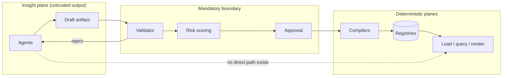

# ADR 0003: Dataset and Visualization Model

## Status

Proposed

## Date

2026-09-08

## Supersedes / Extends

Extends `ADR-0001-core-architecture.md`. Does not supersede it. The five layers defined in ADR-0001 remain authoritative; this ADR adds two layers and defines the data and visual semantics those layers own.

Parallel to, and independent of, `ADR-0002-workflow-execution-model.md`. Neither decision depends on the other. They share conventions and security posture deliberately, and the two systems integrate only through the declared contracts named in §7.6 of `prism-architecture-and-vision.md`.

## Related Documents

- `prism-architecture-and-vision.md` — the full architecture and vision this decision underpins
- `.github/copilot-instructions.md` — repository behavioural rules
- `docs/architecture.md`, `docs/modules.md`, `docs/data-flow.md`
- `docs/agent-workflow.md`, `docs/agent-safety.md`
- `docs/pentest-flow.md`, `docs/ci-cd.md`
- `omniflow-architecture-and-vision.md`, `ADR-0002-workflow-execution-model.md` — the sibling product

---

## Context

The repository defines a layered, zero-trust, agent-governed architecture (ADR-0001). What it does not define is **how external data is represented, refreshed, queried and displayed** — the concrete model that lets a single system replace the reporting estate of a company: spreadsheets on shared drives, departmental Access and SQLite files, exports from line-of-business systems, hand-maintained monthly decks, and the small number of people who can write SQL against a read replica.

Five forces drive this decision.

**1. Silent wrongness is the dominant failure mode.** In file-based reporting the characteristic failure is not a crash. It is a renamed column, a shifted header row, a locale-dependent decimal separator, or a date parsed day-month instead of month-day. Each produces a chart that renders perfectly and is wrong. Any model chosen must make drift *loud* by construction rather than by operator vigilance.

**2. Auditability.** The organisation cannot currently answer "where did this number come from, under what definition, and how old is it?" The model must make that answerable by construction, not by convention.

**3. Zero trust applied to files and to AI.** ADR-0001 mandates that all inputs are untrusted. An uploaded workbook is an input, its cell contents are inputs, and AI output is an input. A model that lets a parser run unconstrained, or lets a model's output reach a published dashboard directly, would violate the repository's foundational posture regardless of how well either performs.

**4. Determinism under refresh.** Reporting data is re-imported — monthly, nightly, on demand, and by accident. A model without first-class identity and idempotency semantics produces duplicated rows, double-counted revenue and irreproducible history. This is the most common and most expensive failure class in data platforms, and it must be addressed in the model rather than in each import.

**5. The visual output is not a by-product.** A chart is the artifact the organisation actually acts on. If it is a rendered image produced by imperative code, it cannot be versioned meaningfully, checked for accessibility, re-rendered server-side identically, safely embedded, explained, or authored by an agent. The visual half needs the same rigour as the data half, or it becomes the weak end of the system.

Additional constraints inherited from the repository:

- module boundaries must remain strict, with no cross-module state sharing,
- security must be embedded in every layer, not appended,
- CI/CD must remain deterministic and fail-fast,
- all architectural decisions must be documented and diagrammed,
- the multi-agent model must operate under the guardrails of `docs/agent-safety.md`.

---

## Decision

We adopt a **declarative artifact model spanning ingestion and presentation, with a deterministic compiler at each end and an AI authoring plane in front of both**.

The decision has seven parts. All seven are binding together; adopting a subset does not deliver the properties this ADR is intended to secure.

### D1. An import is a compiled contract, not a copy

Ingestion is defined by a **Source Binding**: a declarative, versioned, reviewable document specifying the connector, the structure within the source, a per-column contract (identity, type, locale, role, unit, sensitivity, drift policy), an ordered transform chain, quality expectations, and a refresh mode.

Consequences that follow directly:

- Type inference runs **once**, at bind time, producing ranked candidates with evidence. Ambiguity blocks publication rather than being resolved silently. Inference is never re-run on refresh.
- A column's absence or type change on a later import triggers the column's declared `onMissing` / `onTypeChange` policy, which defaults to **fail**.
- Locale, timezone and date system are properties of the binding, never of the server environment.

### D2. Five artifacts, five lifecycles

| Artifact | Mutability |
|---|---|
| Source Binding | Mutable while draft; immutable once published |
| Import Plan | Always immutable, content-addressed |
| Dataset Version | Always immutable, content-addressed |
| Semantic Model | Mutable while draft; immutable once published |
| View Spec | Versioned; every save is a new version |

The separation between binding and plan is what makes "why did last month's load produce different numbers?" answerable by hash, and makes compilation semantics regression-testable. The same separation exists on the query side, for the same reason.

### D3. All external contact is confined to the connector contract

A **connector** is the only component permitted to touch an external source. It declares its configuration schema, capability flags, pushdown profile, type map, required scopes, egress allow-list, cost model, enumerated failure modes, change-detection fingerprint, and a mandatory dry-run mode.

All untrusted file parsing occurs inside a **network-free, resource-capped sandbox**. Formulas are never evaluated, external references are never resolved, and macros are never executed.

Writing to a source is a separately declared, separately permissioned capability. It is never a side effect of an import.

### D4. A chart is a specification, not a picture

Visual output is defined by a **View Spec**: a declarative grammar of mark, encodings, scales, guides, layers, facets, interactions, formatting and accessibility metadata, referencing a query spec rather than embedding data or SQL.

The specification is **non-Turing-complete**: no scripts, no callbacks, no expressions evaluated at render time. One renderer consumes it for the browser, for headless export and for embedding.

### D5. One query form, compiled with policy injected

Every question asked of the platform — by a chart, by exploration, by an alert, by the API, by an agent — is expressed as a **Query Spec** against a semantic model. There is no surface anywhere that accepts raw SQL from a user or an agent.

The Query Compiler is a pure function producing an immutable, content-addressed execution plan. It injects row-level-security predicates and column masking, verifies aggregation legality against declared measure additivity, enforces mandatory limits and cost budgets, and constructs the plan structurally with bound parameters — never by string concatenation.

Access policy is therefore enforced in exactly one place and applies uniformly to charts, exploration, drill-through, exports, subscriptions, the API and agents. The principal's effective policy is part of every cache key.

### D6. Plane separation, and the AI invariant

The system is divided into six planes — Ingestion, Modeling, Query, Presentation, State, Insight — with a single rule binding them: **the Insight plane, which is where every agent lives, may read everything and write nothing.** Agent output is a draft artifact that crosses the same validator, the same compiler and the same approval path as a human's.

Agents receive profiles, schemas and aggregates by default; raw values only when the task requires them and only within the requesting principal's access scope. Cell content is always framed as data, never as instruction.

Autonomy is a per-workspace, per-artifact-kind tier, T0–T3, defaulting to T1. T3 never extends to certified metrics, sensitivity changes, or anything that widens who can see data.

### D7. Two new layers

`ADR-0001`'s five layers are extended with **Data** (connectors, detection, binding, storage, transforms, semantic model, query) and **Presentation** (view specs, rendering, dashboards, exploration, export, embedding). Dependencies point inward only; Presentation may not reach Data's internals, and Data may not call Presentation.

---

## Rationale

| Decision | Why |
|---|---|
| D1 — import as contract | A declared column contract is the only mechanism that converts a silent wrongness failure into a loud one. Everything else in the product depends on being able to say "the source no longer matches what was agreed" — and to say it before a chart renders. Deferring inference to query time, the obvious alternative, makes the same file produce different answers on different days |
| D2 — five artifacts | Separating the human-readable binding from the fully resolved plan makes "why did that specific load behave that way?" answerable by hash, and makes compilation semantics regression-testable by asserting plan hashes in CI |
| D3 — connector boundary and parse sandbox | Confining all external contact to one contract means absorbing a new class of source requires a connector, not an engine change. Parsing untrusted files is the largest attack surface in this product; a network-free sandbox devalues an entire class of parser vulnerability rather than defending against each instance |
| D4 — chart as specification | A specification can be versioned, diffed, validated for accessibility, rendered identically in three targets, embedded safely, explained in prose and authored by an agent. Imperative rendering code can be none of those things cheaply. It is also what prevents the export from ever disagreeing with the screen |
| D5 — one query form, policy at compile time | A single question format with structural plan construction removes the injection class entirely rather than defending against it. Injecting RLS at compilation is the only way to guarantee that a policy is not forgotten on the fourth surface someone adds. Including the policy fingerprint in the cache key closes the most common silent cross-user leak in this product category |
| D6 — plane separation and the AI invariant | The structural expression of ADR-0001's zero-trust mandate applied to AI, in a product where the AI reads attacker-influenceable spreadsheet cells. It bounds the worst case of a model failure or a prompt injection to a rejected draft rather than a wrong number on an executive dashboard |
| D7 — two new layers | Data processing and visual rendering have genuinely different shapes, failure modes and testing strategies — numeric assertion versus visual regression. Folding either into "Modules", or folding Presentation into Data, would erode the boundary discipline ADR-0001 exists to protect |

---

## Consequences

### Positive

- A source that changes shape produces a clear, owned, actionable finding instead of a wrong chart.
- Every number resolves, in one step, to a dataset version, a binding version, a source fingerprint and an ingestion time.
- Re-import is safe and repeatable; identical content produces no new version at all.
- Static analysis, quality expectations and pentest heuristics can run over bindings and query specs before anything executes.
- Access policy is enforced once and is uniform across every surface, including the ones added later.
- Charts are portable, accessible, server-renderable and embeddable artifacts, and the export always matches the screen.
- AI authoring becomes available across both halves of the product without weakening the zero-trust posture.
- Migration can be incremental: a workbook's output sheet is imported as-is on day one and decomposed later.
- One observability surface answers freshness, quality, cost and usage questions across every source and every dashboard.

### Negative

- Expressiveness is deliberately limited on both ends. Some data preparation will need a connector or an upstream change rather than an inline expression, and some exotic visuals will need a spec extension rather than custom code. This is a real cost, accepted knowingly.
- Four contracts — the column contract, the connector contract, the query spec and the view spec — become public and expensive to change. They must be designed conservatively and kept small initially.
- Requiring a human to resolve genuinely ambiguous inference adds friction to the first-run experience. Mitigated by workspace defaults and by agent proposals, but not eliminated, and deliberately so.
- Structure detection, inference, compilation, versioning and a spec-driven renderer are meaningful engineering work before the first genuinely messy workbook imports cleanly.
- Immutable dataset versions consume storage that a mutable table would not, requiring an explicit retention policy per binding.
- The parse sandbox, required for the primary use case, is the largest security surface in the system and needs specific hardening, a malicious-file corpus and its own review cadence.
- The platform becomes a critical dependency for company reporting and must be operated accordingly: separate worker pools, durable queues, per-binding kill switches and a tested restore procedure.

### Neutral

- Contracts first, technology second: this decision constrains boundaries and semantics, not language or engine choice. The recommended defaults in §18 of the vision document are replaceable behind the engine profile and the view spec.
- Existing repository conventions (Python `snake_case`, PowerShell `Verb-Noun`, kebab-case files and folders) continue to apply to whatever is chosen.
- Container-first deployment. Kubernetes is optional and deferred; the container contract does not change when it is adopted.
- The decision is independent of ADR-0002. Prism and OmniFlow may be deployed together or separately, and integrate only through the three declared contracts.

---

## Alternatives Considered

### A1. Ad-hoc load with inference at read time

Load files into a generic store and infer types when queried, as desktop analysis tools do.

Rejected: the same file produces different results on different days, drift is undetectable by construction, and there is nothing to review, diff or roll back. It fails the first force in Context outright.

### A2. Adopt an existing open-source BI platform and extend it

Rejected as the architectural basis, though individual components remain sensible defaults (§18 of the vision document). Existing platforms treat ingestion as a solved prerequisite and start at the semantic layer, which is precisely where the hard, differentiating problem is *not*. Their access models are typically per-surface rather than compiled in, which conflicts with D5 and would have to be undone rather than extended.

### A3. Notebook-first: code as the interface

Rejected: it inverts the audience. The people who own the spreadsheets cannot write the code, and code-defined charts are not reviewable, accessible-checkable or safely agent-authorable. A notebook surface may later be added *over* the query spec as an expert path; it cannot be the model.

### A4. Direct-query only — never copy data

Rejected as a universal rule, accepted as a mode (§7.3 of the vision document). Files have no engine to push down to, and the primary use case is files. Making pushdown a declared connector capability rather than a global architecture keeps both options available.

### A5. Charts as configuration objects of a charting library

Rejected: the library's configuration format becomes the schema by default, which surrenders portability, prevents identical server-side rendering, makes accessibility rules uncheckable, and means a library migration invalidates every saved chart.

### A6. Build it as an OmniFlow capability family

Rejected: it would couple two products with different lifecycles, different critical paths and different audiences, and would put interactive query latency behind a workflow engine designed for background execution. Integration through three declared contracts gives the useful part of the coupling with none of the cost.

---

## Compliance and Validation

A change is compliant with this ADR when all of the following hold, each enforced in CI per §19 of the vision document:

| Check | Enforcement |
|---|---|
| No published binding contains an `auto` type or an unresolved ambiguity | Schema validation |
| No `upsert` refresh mode without a declared `identity` | Binding Compiler |
| Compilation is deterministic | Plan-hash snapshot tests |
| Parsing occurs only inside the sandbox, and the sandbox has no network | Static analysis plus an escape-attempt corpus |
| No code path constructs a query by concatenating user-supplied values | Static analysis plus an injection corpus |
| Row-level security is applied at compilation and present in every cache key | Bypass tests across chart, exploration, drill-through, export, subscription, API and agent surfaces |
| No agent has a write path to a registry | Static analysis of module boundaries |
| Every view spec validates against the schema and passes accessibility rules | Schema validation plus accessibility checks |
| The renderer produces identical output for screen, export and embed | Visual regression tests across targets |
| Layer dependencies point inward only | Architecture rule enforcement in static analysis |

---

## Review Triggers

This ADR must be revisited if any of the following occurs:

- The transform set or the expression language is proposed to gain loops, recursion or arbitrary function definition (this would void D1 and D4's non-Turing-complete guarantee).
- A surface is proposed that accepts raw SQL from a user or an agent (this would void D5).
- An agent is proposed to receive a direct write path to any registry (this would void D6).
- The column contract, the connector contract, the query spec or the view spec requires a breaking major version.
- An open table format is adopted for the dataset store, changing the Data layer's internal boundaries (see Q1).
- The platform is proposed to write back to source systems beyond the narrow cases of §7.5 (see Q9).
- Multi-tenancy or residency requirements change the isolation model.

---

## Final Notes

ADR-0003 defines the data and visual foundation for the Prism platform. Any major change to the column contract, the connector contract, the query spec, the view spec, the plane boundaries or the policy-enforcement point must reference and extend this ADR.

All Copilot Agents must treat this ADR as authoritative when analyzing or modifying the platform's ingestion, query or presentation behaviour.
