# Prism — Self-Hosted Data Platform

**Architecture & Vision**

| Field | Value |
|---|---|
| Document ID | `prism-architecture-and-vision` |
| Status | Draft for review |
| Version | 1.0 |
| Date | 2026-09-08 |
| Authoritative parents | `.github/copilot-instructions.md`, `docs/architecture.md`, `docs/adr/ADR-0001-core-architecture.md` |
| Related decision | `ADR-0003-dataset-and-visualization-model` |
| Sibling product | `omniflow-architecture-and-vision` — architecturally aligned, independently deployable |
| Audience | Developers, architects, data engineers, security engineers, technical leadership |
| Deployment assumption | Container-first, self-hosted (Docker Compose for dev/single node, Kubernetes optional later) |
| Stack assumption | Contracts first — boundaries are mandatory, technologies are recommended defaults with named alternatives (§18) |

---

## Table of Contents

1. [Purpose](#1-purpose)
2. [Vision](#2-vision)
3. [System Overview](#3-system-overview)
4. [Architecture Layers](#4-architecture-layers)
5. [Component Model](#5-component-model)
6. [The Data Model](#6-the-data-model)
7. [Connector Model — How the System Reaches Sources](#7-connector-model--how-the-system-reaches-sources)
8. [Semantic Model and the Metric Layer](#8-semantic-model-and-the-metric-layer)
9. [Visualization Model](#9-visualization-model)
10. [Query and Execution Lifecycle](#10-query-and-execution-lifecycle)
11. [Data Flow and Contracts](#11-data-flow-and-contracts)
12. [AI Agent Model](#12-ai-agent-model)
13. [Security Model](#13-security-model)
14. [Reliability and Failure Model](#14-reliability-and-failure-model)
15. [Observability and the Learning Loop](#15-observability-and-the-learning-loop)
16. [Governance, Collaboration and Sharing](#16-governance-collaboration-and-sharing)
17. [Migration Path — Replacing the Spreadsheet Estate](#17-migration-path--replacing-the-spreadsheet-estate)
18. [Technology Choices — Contracts First, Defaults Named](#18-technology-choices--contracts-first-defaults-named)
19. [CI/CD and Testing Strategy](#19-cicd-and-testing-strategy)
20. [Repository Structure](#20-repository-structure)
21. [Build Roadmap](#21-build-roadmap)
22. [Sizing, Team and Effort](#22-sizing-team-and-effort)
23. [Risks and Mitigations](#23-risks-and-mitigations)
24. [Open Questions](#24-open-questions)
25. [Glossary](#25-glossary)

---

## 1. Purpose

This document defines the architecture and product vision for **Prism**, a self-hosted data platform that ingests database and file-based data sources — Excel workbooks first and foremost — turns them into typed, versioned, queryable datasets, and lets people explore and present that data graphically without writing code.

It is written to be **directly buildable**. Every section either constrains a design decision, names a component with a defined responsibility and boundary, or specifies an increment of work. It contains no implementation code by design — code is the developer's output, not the architect's.

The document extends, and must remain consistent with, the standards already established in the repository:

- layered architecture with strict module boundaries (`docs/architecture.md`, `ADR-0001`),
- zero-trust security embedded at every layer (`docs/security.md`, `docs/pentest-flow.md`),
- deterministic, fail-fast CI/CD (`docs/ci-cd.md`),
- documentation-first governance with ADRs (`documentation.agent.md`),
- multi-agent reasoning with hard safety guardrails (`docs/agent-workflow.md`, `docs/agent-safety.md`).

Prism is a **sibling** of OmniFlow, not a subsystem of it. The two share conventions, contracts style and security posture, and each is independently deployable. Where they meet — scheduled refresh, alert delivery, cross-system orchestration — they meet through declared contracts described in §7.6, never through shared internals.

---

## 2. Vision

### 2.1 The problem

Every organisation already has a data platform. It is called Excel, and it runs on laptops.

| Where the data lives | Typical symptom |
|---|---|
| Workbooks on shared drives | Six versions of `budget_final_v3_REAL.xlsx`; nobody knows which is authoritative |
| Workbooks emailed as attachments | The number in the board deck cannot be traced to a source |
| Departmental Access and SQLite files | A single desktop is a production dependency |
| Reports exported from line-of-business systems | Manual, monthly, and stale on arrival |
| A read replica queried by three people who know SQL | Everyone else waits for those three people |
| A BI tool nobody could afford to roll out widely | Dashboards exist for 5% of the questions |

The consequence is not merely duplication. It is that **no single system can answer the question "where did this number come from, is it current, and who else is looking at a different one?"**

Three failures compound:

1. **Import is treated as an event, not a contract.** Someone loads a file once. The next month's file has a renamed column, a shifted header row and a different date format. Nothing detects this; the chart simply becomes wrong.
2. **Type inference is invisible and unrepeatable.** A column of order numbers becomes a float. A German-locale decimal becomes a thousand-separated integer. A date becomes a five-digit serial. These are guesses, made silently, and remade differently on the next import.
3. **Charts are pictures, not artifacts.** A chart is exported as a PNG, pasted into a deck, and immediately loses its lineage, its filters and its refreshability.

### 2.2 The thesis

> **An import is a compiled contract, not a copy. A chart is a specification, not a picture.**

If ingestion is a **versioned, declarative binding** — a document that says *these bytes, from this sheet, starting at this row, with these columns typed this way, under this locale* — then everything else becomes tractable:

- it can be **diffed**, reviewed and rolled back like any artifact,
- it can be **replayed**, so the same file always produces the same dataset,
- it can be **validated** before it runs, so a changed source fails loudly instead of silently poisoning a dashboard,
- and it can be **generated and repaired by an AI agent**, because proposing a constrained data structure that a validator can reject is a vastly safer problem than generating parsing code that a machine will execute.

The same reasoning applies at the other end of the pipeline. If a chart is a declarative specification — data source, filters, aggregation, mark type, encodings, scales, interactions — then it can be version-controlled, reviewed, re-rendered at any size, exported server-side, embedded, explained in prose, checked for accessibility, and authored by an agent under the same validation as a human.

Between the two ends sits one more invariant, inherited directly from the sibling product: **the AI proposes, the engine disposes.** Prism is not "an LLM that reads your spreadsheets". It is a **deterministic data engine with an AI front-end**.

### 2.3 What "import any database file" means

| It means | It does not mean |
|---|---|
| One catalogue, one type system, one lineage graph for every source the company loads | Prism replaces the systems the data comes from |
| Excel, CSV, Access, SQLite, Parquet, and live SQL databases all become the same kind of object: a typed dataset version | A universal importer that reads every proprietary format ever written without an adapter |
| Re-importing next month's file is a governed, validated, diffable event | Silent overwriting of yesterday's numbers |
| The messy realities of real spreadsheets — merged cells, title rows, multi-row headers, locale-specific numbers — are first-class, declared concerns | Prism guesses correctly every time without ever asking a human |
| Large sources are queried in place rather than copied when that is cheaper | Prism is a data warehouse |

### 2.4 What "visualize graphically" means

| It means | It does not mean |
|---|---|
| A grammar of visual specifications covering the standard chart vocabulary, plus dashboards, exploration and drill-down | A drawing tool |
| Charts that stay connected to their query, refresh on a schedule and carry their lineage | Exported images pasted into decks |
| The system proposes a sensible default chart for a given shape of data, and the user overrides it | The system decides and the user cannot argue |
| Accessible output by construction: contrast, colour-blind-safe palettes, no meaning carried by colour alone | Decoration |
| The same specification renders in the browser, in a server-side export and in an embedded view | Three separate rendering codebases that drift |

### 2.5 Product principles

1. **Declarative over imperative.** A binding, a transform, a query and a chart all describe *what*, never *how*. The engine owns *how*.
2. **Determinism by default.** The same source bytes, the same binding version and the same transform version produce a byte-identical dataset version. Type inference happens once, at bind time, and is then a pinned decision — never a fresh guess at query time.
3. **Zero-trust throughout.** Every file, every database response, every cell of user content and every AI-produced artifact is untrusted until validated. Inherited verbatim from `ADR-0001`, non-negotiable.
4. **Read-only by default.** Prism reads sources. Writing back to a source system requires an explicitly declared, separately permissioned write connector, and is never the default behaviour of an import.
5. **Lineage is not optional.** Every number on every chart resolves, in one click, to the dataset version, the binding, the source file hash and the moment of ingestion. A number that cannot be traced is a defect.
6. **Everything is observable.** Imports, queries, renders and exports emit structured, sanitised events. An unobservable pipeline is a broken pipeline.
7. **Fail loudly on drift.** A source whose shape has changed stops the import and raises a finding. It does not "do its best".
8. **Boring core, smart edges.** The query compiler, the type system and the dataset store are deliberately dull, small and heavily tested. Intelligence lives in the profiler, the chart recommender, the connectors and the agents.
9. **Progressive disclosure.** Dropping a file and getting a chart must take under a minute and require no configuration. Every advanced concept in this document — bindings, semantic models, RLS, incremental refresh — must be reachable later, not required first.

### 2.6 Non-goals

- Prism is **not** a data warehouse. It stores what it must, and pushes computation down to the source engine whenever the source can do it better.
- Prism is **not** a general-purpose programming runtime. Transforms are declarative and deliberately non-Turing-complete; logic beyond that boundary belongs in a connector or in an upstream system.
- Prism is **not** a spreadsheet. It does not aim to reproduce cell-level formula editing, and it will not evaluate the formulas inside an imported workbook (§13.4 explains why this is a security position, not a limitation).
- Prism does **not** aim for real-time streaming analytics with sub-second freshness guarantees. It aims for **honest, declared freshness** — every dataset states when it was last refreshed and every chart shows it.
- Prism does **not** replace CI/CD, and does not replace OmniFlow. It may be triggered by either, and may trigger either.

---

## 3. System Overview

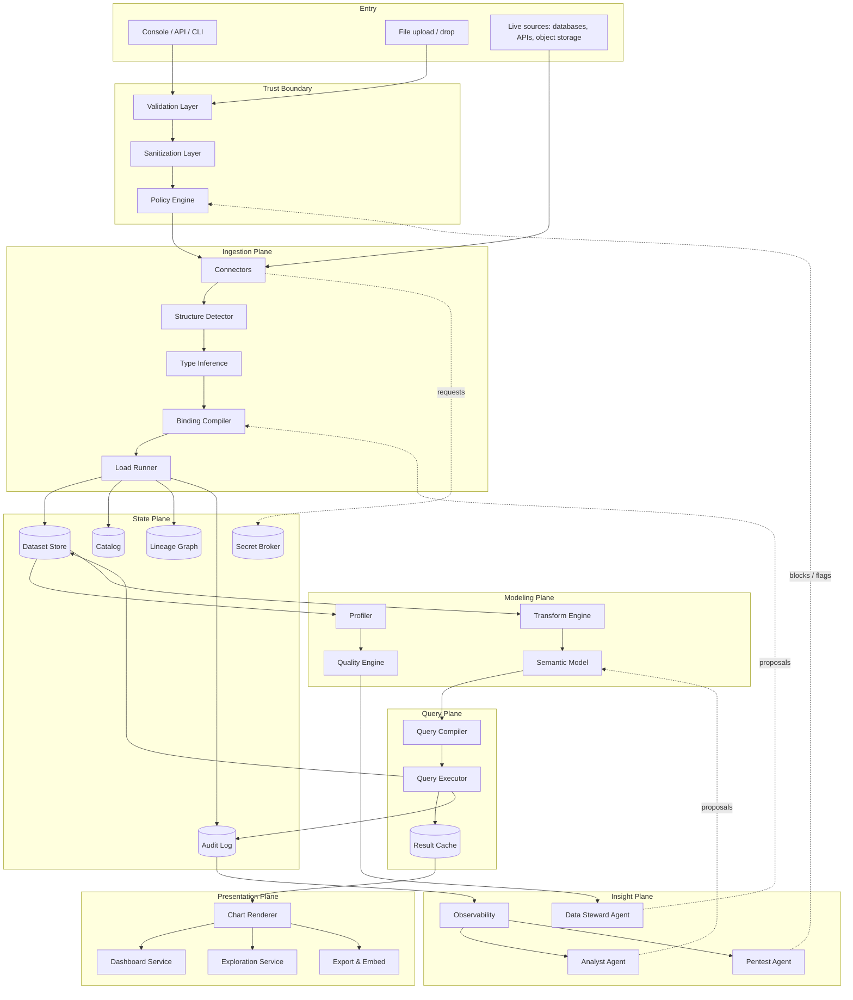

The system separates into six planes, and this separation is the single most important structural decision in the document:

| Plane | Owns | Trust posture | Failure impact |
|---|---|---|---|
| **Ingestion plane** | Turning external bytes into typed, versioned dataset versions | Everything crossing it is untrusted; parsing happens in isolation | New data stops arriving; existing datasets and dashboards keep working |
| **Modeling plane** | Meaning: transforms, relationships, measures, quality expectations | Trusted inputs only — it consumes validated dataset versions | New models cannot be published; published ones keep serving |
| **Query plane** | Turning a query specification into a deterministic engine plan and executing it | Deterministic; no AI in the hot path | Charts stop returning data — this is the critical path |
| **Presentation plane** | Chart specifications, dashboards, exploration, export, embedding | Renders validated specs against validated results | Visual surface degrades; data remains correct and reachable via API |
| **State plane** | Durable facts: catalog, dataset versions, lineage, audit | Append-only where it matters; sanitised; auditable | Loss of traceability and recovery ability |
| **Insight plane** | Reading the state plane and reasoning about it | Read-only; may propose, may never mutate directly | Loss of learning, quality monitoring and threat detection; the rest is unaffected |

**The Insight plane can never write to the Ingestion, Modeling or Query planes directly.** It emits proposals into the authoring surfaces, which are validated like any other input. This is the structural expression of the "AI proposes, engine disposes" rule and the reason an agent failure cannot escalate into a wrong number on an executive dashboard.

---

## 4. Architecture Layers

Prism keeps the five layers defined in `ADR-0001` and adds two. The additions are deliberate and are the subject of `ADR-0003`.

| Layer | Inherited from ADR-0001 | Responsibility in Prism |
|---|---|---|
| **Core** | Yes | Models, the type system, typed value objects, error taxonomy, logging and validation primitives. No business logic, no external calls. |
| **Modules** | Yes | Isolated functional units: catalog, profiler, quality engine, scheduler, notification. |
| **Data** | **New** | Connectors, structure detection, type inference, binding compilation, dataset storage, transforms, the semantic model, query compilation and execution. The heart of the product. |
| **Presentation** | **New** | The visual specification schema, chart rendering, dashboard composition, exploration, export and embedding. |
| **Pipeline** | Yes | CI/CD, deterministic builds, artifact promotion, environment gates. Now also promotes *bindings, models and dashboards* as artifacts, not only code. |
| **Security** | Yes | Zero-trust validation, policy, row- and column-level access, secret brokering, pentest heuristics, risk scoring. |
| **Documentation** | Yes | Architecture, ADRs, generated data dictionaries, system flows. |

Two layers rather than one is a considered choice. Rendering has a genuinely different shape from data processing — different performance characteristics, different failure modes, different testing strategy (visual regression rather than numeric assertion) — and folding it into Data would erode exactly the boundary discipline `ADR-0001` exists to protect.

### 4.1 Dependency rule

Dependencies point **inward only**:

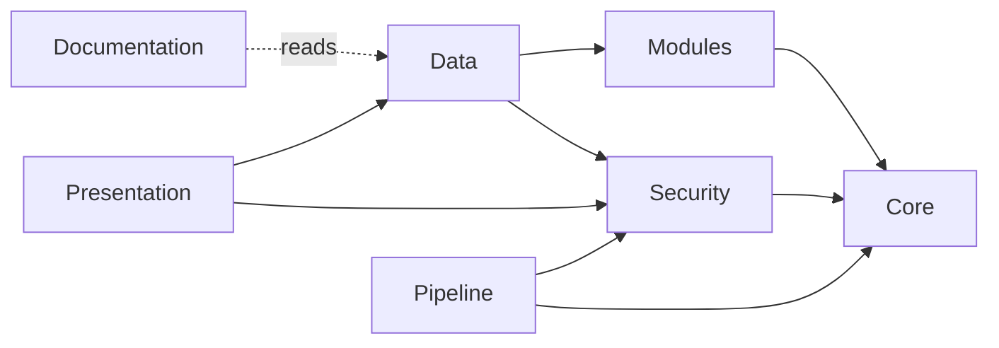

Rules, enforced by static analysis in CI:

- **Core depends on nothing.** A Core file that imports from any other layer is a build failure.
- **Security may be called from anywhere but calls only Core.** It evaluates and blocks; it never performs business logic. Inherited verbatim from `docs/modules.md`.
- **Presentation may not reach the Data layer's internals.** It consumes query results and the semantic model's public contract. It never touches the dataset store, a connector or the query executor directly.
- **Data may not call Presentation.** Server-side chart rendering for exports is a Presentation-layer service invoked through a queue, not a call downward from Data.
- **No cross-module state sharing.** Modules communicate through defined interfaces and the state plane, never through shared mutable memory.
- **No layer may bypass the trust boundary.** There is exactly one path from external bytes to a dataset: Connector → Validator → Sanitizer → Policy → Ingestion. A second path is a design defect, not an optimisation.

---

## 5. Component Model

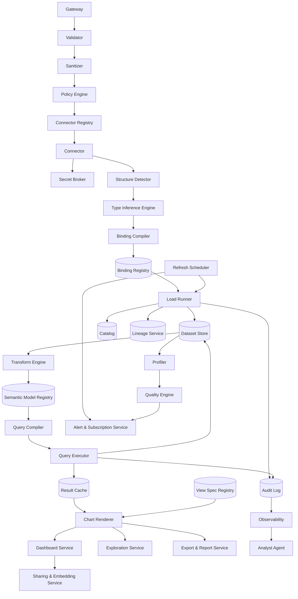

### 5.1 Component responsibilities

| # | Component | Responsibility | Explicit boundaries |
|---|---|---|---|
| 1 | **Gateway** | Sole entry point for humans and external systems. Authentication, session handling, rate limiting, correlation ID assignment, upload streaming. | No business logic. No validation beyond transport-level. |
| 2 | **Validator** | Schema, type, range and pattern validation of every inbound payload and every declarative artifact — bindings, transforms, models, query specs, view specs. Fail-fast with positional errors. | Cannot mutate data. Cannot make policy decisions. |
| 3 | **Sanitizer** | Normalisation, removal of unsafe content, redaction of sensitive fields before anything reaches logs. Neutralises spreadsheet formula-injection payloads on export. | Cannot reject — rejection is the Validator's job. |
| 4 | **Policy Engine** | Authorisation: may this principal read this dataset, see these columns, these rows, run this query, share this dashboard, register this connector? Evaluates risk score from the Pentest Agent. | Cannot execute. Returns allow / deny / require-approval with a reason code. |
| 5 | **Connector Registry** | Catalogue of available connectors: name, semantic version, capability flags (pushdown, incremental, CDC, write), typed configuration schema, required scopes, cost class. | Purely declarative metadata. |
| 6 | **Connector** | The only component permitted to touch an external source. Maps a typed configuration to a protocol or parser and returns a typed record stream plus a source fingerprint. | One connector, one source family. No business logic, no type inference decisions of its own. |
| 7 | **Secret Broker** | Issues short-lived, narrowly scoped credentials to a connector for the duration of one operation. | Secrets never enter a binding, the catalog, a dataset, the audit log or a chart specification. |
| 8 | **Structure Detector** | Finds the *shape* inside a source: which sheets contain tables, where the header row starts, whether headers span multiple rows, which regions are titles, notes or totals, whether a sheet is a cross-tab that needs unpivoting. | Proposes a structure with confidence scores. Never decides silently — a low-confidence result requires confirmation. |
| 9 | **Type Inference Engine** | Assigns a column type, nullability, locale, format and semantic role from a sample plus the full column scan. Produces a ranked candidate list, not a single guess. | Runs at bind time only. Never re-infers at query time. |
| 10 | **Binding Compiler** | Deterministically transforms a source binding into an immutable **import plan**: resolved connector version, resolved column contract, resolved transform chain, resolved target schema. | Pure function. Same binding plus same registry state yields a byte-identical plan and plan hash. |
| 11 | **Binding Registry** | Immutable, content-addressed store of published binding versions with lineage, owner and approval record. | Append-only. Published versions are never edited, only superseded. |
| 12 | **Load Runner** | Executes one import plan: streams records, applies the column contract, writes a new dataset version, computes statistics, emits events. Isolated, resource-capped, time-budgeted. | Stateless between imports. Cannot reach the network except through a Connector. |
| 13 | **Dataset Store** | Durable columnar storage of dataset versions, partitioned and statistics-annotated. Content-addressed by plan hash plus source fingerprint. | Not a general-purpose application database. Versions are immutable. |
| 14 | **Catalog** | The searchable index of everything: sources, bindings, datasets, columns, models, metrics, dashboards — with descriptions, owners, tags, certification status and freshness. | Metadata only. Holds no rows. |
| 15 | **Lineage Service** | Maintains the directed graph from source file or table → binding → dataset version → transform → model → metric → chart → dashboard, and answers impact questions in both directions. | Derived and rebuildable from the audit log. Never authoritative on its own. |
| 16 | **Profiler** | Computes per-column statistics on every dataset version: cardinality, null rate, min/max, distribution sketch, pattern clusters, candidate keys, candidate relationships. | Read-only. Produces facts, never modifies a dataset. |
| 17 | **Quality Engine** | Evaluates declared expectations against a dataset version — schema drift, null thresholds, uniqueness, referential integrity, range and freshness — and blocks promotion on a failure of a blocking expectation. | Cannot repair data. Emits findings and blocks. |
| 18 | **Transform Engine** | Applies the declarative transform chain: rename, cast, split, trim, unpivot, pivot, join, union, filter, derive, deduplicate, bucket. Non-Turing-complete by construction. | No side effects. No external calls. Every transform is reversible in description, if not in data. |
| 19 | **Semantic Model Registry** | Immutable versioned store of semantic models: entities, relationships, dimensions, measures, metrics, hierarchies, default formats and synonyms. | Append-only. The contract every query is written against. |
| 20 | **Query Compiler** | Transforms a query specification plus a semantic model into an immutable, engine-specific execution plan: joins resolved, aggregations pushed down, filters including row-level-security predicates injected, limits enforced. | Pure function. Never assembles a query by string concatenation of user input. |
| 21 | **Query Executor** | Runs a compiled plan against the target engine — the local analytical engine over the dataset store, or a live source in pushdown mode — under a time, row and cost budget. | Cannot alter the plan. Cannot escalate a budget. |
| 22 | **Result Cache** | Keyed by plan hash plus dataset version plus the principal's access-policy fingerprint. Invalidated by dataset version change, model change or policy change. | Never serves a result across a policy boundary. |
| 23 | **View Spec Registry** | Versioned store of chart and dashboard specifications with owner, lineage and certification status. | Specifications only. Holds no results. |
| 24 | **Chart Renderer** | Turns a validated view specification plus a result set into a rendered visual — in the browser, or headless for exports. One specification, one rendering semantic. | Cannot query. Receives results; never fetches them. |
| 25 | **Dashboard Service** | Composes charts into layouts with shared filters, parameters, cross-filtering and refresh policy. | Layout and coordination only. Delegates every query. |
| 26 | **Exploration Service** | Ad-hoc analysis: pivot, drill-down, drill-through, breakdown-by, comparison. Turns interactions into query specs. | Produces query specs; never bypasses the Query Compiler. |
| 27 | **Export & Report Service** | Server-side rendering to PDF, PNG, XLSX and CSV; scheduled report generation; paginated output. | Applies the same policy checks as an interactive view. No privileged path. |
| 28 | **Sharing & Embedding Service** | Public links, signed embed tokens, workspace-scoped sharing, guest access with time limits. | Issues scoped, revocable, expiring tokens only. Never a token with more rights than the sharer holds. |
| 29 | **Alert & Subscription Service** | Threshold and anomaly alerts over metrics; scheduled deliveries of dashboards and reports. | Reads results; sends through a notification connector. Cannot modify data. |
| 30 | **Refresh Scheduler** | Decides when imports and cached aggregates refresh. Concurrency limits, priorities, backpressure, deduplication windows, cost ceilings. | Does not know what an import does. |
| 31 | **Audit Log** | Append-only, sanitised, schema-enforced record of every import, query, render, export, share and policy decision. | Immutable. No deletes, no updates. |
| 32 | **Observability** | Metrics, traces, structured log aggregation, dashboards, alerting on SLOs. | Read-only over the audit log and metrics. |
| 33 | **Analyst Agent** | Natural-language question → query specification and chart specification; explanation of an existing chart; proposed dashboards. | Output is always a draft specification. Never executes a raw query. |
| 34 | **Data Steward Agent** | Proposes bindings for a new file, repairs a binding after schema drift, proposes column descriptions, detects near-duplicate datasets. | Proposals only. Never publishes a binding. |
| 35 | **Pentest Agent** | Applies `docs/pentest-flow.md` heuristics to bindings, transforms, query specs, share scopes and audit history. Produces risk scores and blocking findings. | May block via the Policy Engine; may never edit an artifact. |
| 36 | **Documentation Agent** | Generates and maintains the data dictionary, model documentation and dashboard descriptions. | Documentation only. |

The count is deliberately high because the boundaries are what make the system buildable incrementally. Phase 0 (§21) implements eleven of these components; the rest have a defined home to arrive into rather than being retrofitted.

---
## 6. The Data Model

This section is the specification a developer implements first. Everything else is scaffolding around it.

### 6.1 Five artifacts, five lifecycles

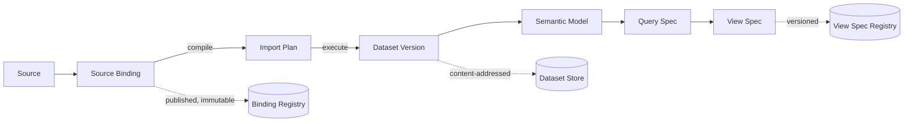

| Artifact | Mutability | Produced by | Consumed by |
|---|---|---|---|
| **Source Binding** | Mutable while draft; immutable once published | Human author, or the Data Steward Agent | Binding Compiler |
| **Import Plan** | Always immutable, content-addressed by hash | Binding Compiler | Load Runner |
| **Dataset Version** | Always immutable, content-addressed | Load Runner | Transform Engine, Profiler, Query Executor |
| **Semantic Model** | Mutable while draft; immutable once published | Human author, or the Analyst Agent | Query Compiler |
| **View Spec** | Versioned; every save is a new version | Human author, or the Analyst Agent | Chart Renderer |

The separation between binding and plan matters more than it appears. It is what allows an import to be reviewed as a human-readable document while being executed as a fully resolved, unambiguous instruction set — and what makes "why did last month's load produce different numbers?" answerable, because the exact plan hash is recorded on the dataset version.

### 6.2 Source Binding anatomy

A source binding is a declarative document (YAML for authoring, JSON for transport — the same schema).

| Section | Required | Purpose |
|---|---|---|
| `apiVersion` | yes | Binding schema version. Enables forward migration. |
| `kind` | yes | `SourceBinding`. |
| `metadata` | yes | Name (kebab-case), version (semver), owner, team, description, tags, criticality tier. |
| `source` | yes | Connector name and version constraint, plus the connector's typed configuration (path, sheet, table, query, endpoint). |
| `credentials` | no | A *reference* to a secret, never a secret. Resolved by the Secret Broker at load time. |
| `structure` | yes | Where the table is: sheet selector, header row range, data row range, skip rules, footer detection, cross-tab unpivot declaration. |
| `columns` | yes | The **column contract**: for each column, source identity, target name, type, nullability, locale, format, semantic role, sensitivity, and drift policy. |
| `transforms` | no | An ordered, declarative transform chain applied during load. See §6.7. |
| `expectations` | no | Quality assertions evaluated against every produced dataset version. Blocking or advisory. |
| `refresh` | no | Schedule, mode (`snapshot`, `append`, `upsert`, `partition-replace`), watermark column, late-arrival window. |
| `identity` | conditional | Business key columns. Required for `upsert` mode; the compiler rejects `upsert` without one. |
| `retention` | no | How many dataset versions to keep, and for how long. |
| `policy` | no | Access defaults, data classification, residency constraint, masking rules. |

Everything not in the schema is a validation error. There is no escape hatch for arbitrary expressions beyond a small, sandboxed expression language used in filters and derived columns — deliberately not Turing-complete.

### 6.3 The column contract

The column contract is the single most consequential structure in the product. It is what turns "someone loaded a spreadsheet" into "this dataset has a defined shape that a change can violate".

| Field | Meaning |
|---|---|
| `sourceRef` | How the column is located in the source: header text, positional index, or both — with a declared precedence. Positional-only bindings are flagged as fragile. |
| `name` | Target column name, snake_case, stable across versions. Renaming is a breaking change. |
| `type` | One of the platform types (§6.4). Never `auto` in a published binding. |
| `nullable` | Whether nulls are permitted. A null in a non-nullable column is a load failure, not a silent coercion. |
| `locale` | Decimal separator, thousands separator, date order, timezone assumption. Explicit, never inherited from the server's environment. |
| `format` | Parse pattern for dates, times and numbers where the type alone is insufficient. |
| `role` | Semantic role: `dimension`, `measure`, `key`, `timestamp`, `geo`, `identifier`, `free-text`. Drives default aggregation and default chart selection. |
| `unit` | Currency, percentage, byte, duration. Drives display formatting and prevents summing incompatible values. |
| `sensitivity` | `public`, `internal`, `confidential`, `secret`. Drives masking, redaction and residency. |
| `onMissing` | What to do if the column is absent on the next import: `fail`, `null-fill`, `warn`. Default is `fail`. |
| `onTypeChange` | What to do if the inferred type of incoming data no longer matches: `fail`, `quarantine-rows`, `warn`. Default is `fail`. |
| `description` | Human documentation, surfaced in the catalog and the data dictionary. |

`onMissing` and `onTypeChange` defaulting to `fail` is the single decision that separates this platform from a spreadsheet. Silence on drift is how wrong numbers reach a board pack.

### 6.4 The type system

A small, closed type system, chosen so that every supported storage and query engine can represent it without loss.

| Type | Notes |
|---|---|
| `boolean` | Explicit true/false mapping declared in the binding — "Y"/"N", "1"/"0", "TAK"/"NIE" are all binding-level concerns, never runtime guesses. |
| `integer` | 64-bit. |
| `decimal` | Fixed precision and scale, declared. **Money is never a float** — the compiler rejects a `currency` unit on a `float` column. |
| `float` | 64-bit IEEE. For measurements, not for money. |
| `date` | Calendar date, no time, no zone. |
| `time` | Time of day, no date. |
| `timestamp` | Instant, with a declared timezone or a declared "naive" assumption. Never ambiguous. |
| `duration` | Fixed-precision interval. |
| `string` | UTF-8, with an optional declared maximum length. |
| `categorical` | String with a bounded, catalogued domain. Enables efficient storage and correct legend ordering. |
| `json` | Semi-structured payload, addressable by declared path extraction in transforms. |
| `binary` | Opaque bytes, stored by reference. Never inlined into a query result. |
| `geo` | Point, line or polygon with a declared coordinate reference system. |
| `null` | Not a type; a property of a column. There is no "empty string means null" behaviour that is not explicitly declared. |

### 6.5 Type inference — a ranked proposal, never a silent decision

Inference runs once, at bind time, over a stratified sample plus a full scan of the candidate column, and produces a **ranked list of candidates with confidence and evidence**, not a verdict.

| Rung | Test | Evidence recorded |
|---|---|---|
| 1 | Native source type, if the source has one (a database column, a Parquet schema) | Type is adopted directly; confidence 1.0 |
| 2 | Uniform structural pattern across all non-empty values | Match rate, exemplar values, exception values |
| 3 | Locale-sensitive numeric and date patterns, tried per candidate locale | Which locale won, by what margin |
| 4 | Domain heuristics: cardinality ratio for `categorical`, key uniqueness for `key`, monotonicity for `timestamp` | Cardinality, uniqueness, ordering |
| 5 | Column name signals, in the languages configured for the workspace | Which token matched; always the weakest signal, never sufficient alone |

Rules that the Binding Compiler enforces:

- **Ambiguity is surfaced, not resolved.** If two candidates are within the configured confidence margin — the classic `03/04/2026` day-month versus month-day case — the binding cannot be published until a human or an explicit workspace default chooses. Guessing here is how a year of data silently transposes.
- **Exceptions are counted and shown.** "98.7% match, 412 exceptions" with exemplars is far more useful than a type that quietly coerced 412 values to null.
- **Inference is not re-run on refresh.** The next import applies the pinned contract. A mismatch raises `onTypeChange`, it does not re-infer.

### 6.6 The Excel problem, specifically

Excel is the primary source and deserves its own specification, because "read a spreadsheet" is a genuinely hard problem that generic table readers fail at. The Structure Detector must handle, and the binding must be able to declare, all of the following.

| Reality | Handling |
|---|---|
| Title rows, logos, and notes above the table | Header-row detection scores each row by type homogeneity, fill ratio and distinctness; the chosen row is declared explicitly in the binding, never re-detected on refresh |
| Multi-row headers (`Q1` spanning `Actual`/`Budget`) | Declared as a header range; columns are named by joining the levels with a declared separator, or unpivoted per §6.7 |
| Merged cells | Forward-filled across the merge range, with the merge recorded as evidence; a merged cell inside a data region is a warning, not a silent fill |
| Multiple tables on one sheet | Region detection proposes each contiguous block as a candidate; a binding targets exactly one region |
| Cross-tab layout (months across the top) | Declared `unpivot` with an explicit id-column set; this is the most common single transform in real workbooks |
| Total and subtotal rows | Detected by formula presence, label patterns and arithmetic verification; excluded by declared rule, never by row index |
| Formulas | **Never evaluated.** The cached value is read; if a cell has no cached value, it is a load error, not a computation request. See §13.4 |
| Dates as serial numbers, and the 1900 leap-year bug | Converted with the workbook's declared date system, which is read from the file, not assumed |
| Locale-specific numbers (`1 234,56`) | Handled by the column's declared `locale`, not by the server's environment |
| Text-formatted numbers and numbers stored as text | Detected, reported, and converted only by explicit declaration |
| Leading apostrophes, trailing spaces, non-breaking spaces | Normalised by declared trim rules; the raw value is preserved in the quarantine record when a row fails |
| Hidden rows, columns and sheets | Included or excluded by explicit declaration; the default is to exclude hidden sheets and include hidden rows, and to say so in the load report |
| Colour-encoded meaning ("red rows are cancelled") | Read as a declared attribute column when the binding asks for it; otherwise reported as an unmodelled signal, because it is a common source of lost information |
| Multiple sheets with identical shape (one per month) | Declared as a sheet-glob with a `sheet_name` provenance column, unioned into one dataset |
| `.xls`, `.xlsx`, `.xlsm`, `.csv` with unknown encoding and delimiter | Encoding and delimiter detection with confidence, declared in the binding once chosen |
| External workbook links, remote references | Never followed. Reported as a finding |
| Macros | Never executed. Their presence is a finding that raises the source's risk score |

The load report produced for every import states, in plain language, what was detected, what was skipped, what was coerced and what was quarantined. A user who does not read it is still protected, because anything ambiguous blocked publication in the first place.

### 6.7 The transform contract

Transforms are declarative, ordered, and individually typed: each declares its input schema requirement and its output schema. The compiler verifies the chain end to end, so an invalid transform is a compile error rather than a runtime surprise.

| Transform | Purpose |
|---|---|
| `rename` | Map source names to target names |
| `cast` | Change a column's type with a declared failure policy |
| `trim` / `normalize` | Whitespace, case, unicode normalisation, accent folding |
| `split` / `concat` | Column decomposition and composition with a declared delimiter |
| `derive` | New column from a sandboxed expression over existing columns |
| `filter` | Row exclusion by predicate |
| `deduplicate` | By declared key, with a declared tie-break ordering |
| `unpivot` | Wide to long — the single most valuable transform for spreadsheet sources |
| `pivot` | Long to wide, with a bounded, declared column domain |
| `join` | Against another dataset version, with a declared join type and pinned version |
| `union` | Of datasets with a compatible contract |
| `aggregate` | Pre-aggregation at load time, when the raw grain is not needed |
| `bucket` | Numeric binning or date truncation with declared boundaries |
| `lookup` | Value mapping from a declared, versioned reference table |
| `mask` | Irreversible redaction of a sensitive column at load time |
| `quarantine` | Route rows failing a predicate to a side dataset rather than failing the whole load |

`quarantine` deserves emphasis. The alternative designs — fail the whole import, or drop bad rows silently — are both wrong in practice. Quarantining preserves the bad rows, with their reason, in an inspectable side dataset, and reports the count on the main dataset's freshness banner. Partial success that is visible is better than either total failure or invisible loss.

### 6.8 Determinism, idempotency and refresh

Three rules make replay and refresh safe, and they are enforced by the compiler rather than left to authors:

1. **No hidden environment.** Locale, timezone and date system are properties of the binding, never of the server. The same file imported on a machine in Warsaw and one in São Paulo produces identical output.
2. **No hidden time.** `context.now` is fixed at import start and recorded on the dataset version. Derived columns using "today" read that value.
3. **Refresh mode declares identity.** `snapshot` replaces; `append` adds with a watermark; `upsert` requires a declared business key; `partition-replace` requires a declared partition column. An `upsert` without `identity` is a compile error. This single rule removes the majority of duplicate-row incidents that plague file-based pipelines.

Re-importing byte-identical source content against an unchanged plan is a no-op that produces no new dataset version — detected by comparing the source fingerprint and the plan hash. This makes an over-eager schedule harmless.

### 6.9 Versioning and compatibility

| Change | Semver impact | Requires |
|---|---|---|
| Adding an optional column with `onMissing: null-fill` | Minor | Review |
| Adding a transform that does not alter existing columns | Minor | Review |
| Adding an advisory expectation | Minor | Review |
| Changing a column `name`, `type`, `unit` or `role` | Major | Review; impact analysis over dependent models and dashboards |
| Changing `refresh.mode` or `identity` | Major | Review plus Data Steward sign-off |
| Changing `sensitivity` upward | Major | Review plus security sign-off; existing shares re-evaluated |
| Editing a published binding version in place | **Forbidden** | Publish a new version |

Every dataset version records the binding version and plan hash that produced it, so a dashboard can always answer which contract its numbers were built under. The Lineage Service turns a proposed major change into an impact list — "this breaks 3 models, 11 charts and 2 scheduled reports" — *before* the change is published, not after.

---

## 7. Connector Model — How the System Reaches Sources

A **connector** is the unit of integration. It is the only path from Prism to anything external, and it is what makes the system genuinely able to absorb arbitrary sources: supporting a new class of source means writing a connector, not changing the engine.

### 7.1 Connector declaration

| Field | Purpose |
|---|---|
| `name` / `version` | Kebab-case identity, semver. |
| `configSchema` | Typed configuration contract, validated before any connection is attempted. |
| `capabilities` | Declared flags: `pushdown`, `incremental`, `cdc`, `random-access`, `schema-discovery`, `write`. The planner reads these; it never probes. |
| `pushdownProfile` | Which operations the source can execute itself: filter, project, aggregate, join, window, limit. Determines what the Query Compiler may delegate. |
| `typeMap` | Source type → platform type, bidirectionally, with declared lossy conversions. |
| `scopes` | Permissions the connector requires. The Secret Broker issues only these. |
| `egress` | Explicit allow-list of hosts and ports. Anything else is blocked at the sandbox boundary. |
| `costModel` | Declared cost per operation (monetary, row-scan, rate-limit units, or latency class) for scheduling and budgeting. |
| `failureModes` | Enumerated error classes with retryability, so the Load Runner does not guess. |
| `fingerprint` | How to compute a cheap change-detection signal: content hash, ETag, modification time, or max-watermark query. |
| `dataClassification` | Highest sensitivity of data this connector may handle. |
| `dryRun` | Mandatory. Reads and validates without persisting, used by binding preview and by migration shadow-mode. |

The `dryRun` flag is mandatory from the first connector, exactly as the equivalent flag is in the sibling product. Retrofitting it later is expensive; it is what makes safe preview and safe cutover possible at all.

### 7.2 Connector families to ship

Ordered by how much source surface each one absorbs:

| Family | Absorbs | Priority |
|---|---|---|
| Spreadsheet: `.xlsx`, `.xlsm`, `.xls`, `.ods` | The primary use case; the majority of departmental data | P0 |
| Delimited text: CSV, TSV, fixed-width, with encoding and delimiter detection | Every system's export button | P0 |
| Embedded databases: SQLite, Access `.mdb`/`.accdb`, dBase `.dbf` | Legacy departmental applications | P0 |
| Relational databases: PostgreSQL, MySQL/MariaDB, SQL Server, Oracle | Line-of-business systems, read replicas | P0 |
| Columnar files: Parquet, ORC, Arrow, Feather | Data engineering output, efficient interchange | P1 |
| Object storage: S3-compatible, Azure Blob, GCS, SMB/NFS shares | Where the files actually live | P1 |
| Semi-structured: JSON, NDJSON, XML, YAML with declared path extraction | API dumps, application exports | P1 |
| Cloud spreadsheets: Google Sheets, Excel Online | Live collaborative sources | P1 |
| HTTP / REST / GraphQL with declared pagination and auth | The long tail of SaaS and internal APIs | P1 |
| Analytical warehouses: Snowflake, BigQuery, Redshift, ClickHouse, Databricks | Where the big data already is; pushdown-first | P2 |
| Statistical formats: SPSS `.sav`, SAS, Stata | Research, actuarial, public-sector datasets | P2 |
| Geospatial: GeoJSON, Shapefile, GeoPackage, KML | Map visualisations | P2 |
| Document tables: PDF table extraction | Regulatory filings, supplier statements | P3 |
| Change data capture: logical replication, Debezium-compatible streams | Near-real-time freshness | P3 |
| Notification and delivery: email, chat, ticketing, webhook | Alert and subscription output | P1 |

The **spreadsheet connector** is the product's centre of gravity. It is also, per §13.4, the largest single attack surface in the system, which is why it is the most heavily constrained.

### 7.3 Materialize or push down

The decision is made by the compiler from declared facts, not by a human choosing a mode:

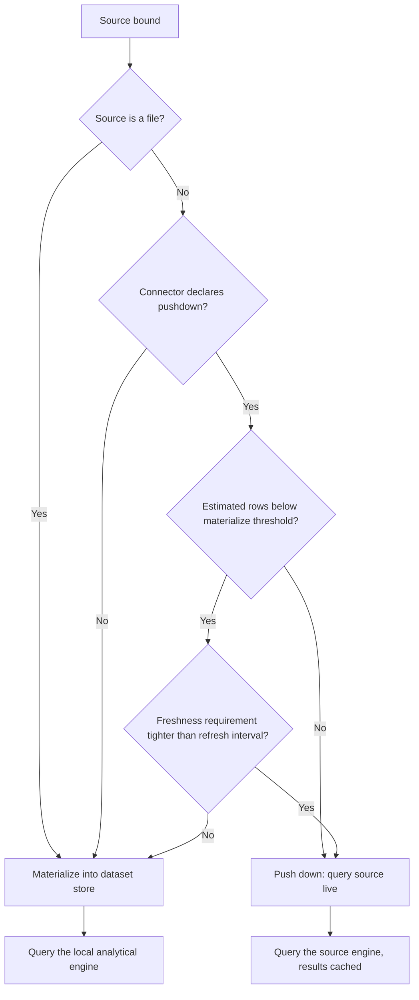

| Mode | When | Trade-off |
|---|---|---|
| **Materialize** | Files always; small-to-medium tables; sources that are slow, rate-limited, expensive or fragile | Fast and predictable queries; data is as fresh as the last refresh |
| **Push down** | Large tables in capable engines; strict freshness requirements; data that may not be copied for residency reasons | Always current; query latency and cost depend on a system Prism does not control |
| **Hybrid** | Push down for detail, materialize pre-aggregates for dashboards | Best of both; requires the aggregate's staleness to be displayed honestly |

Whatever the mode, **the freshness of every chart is displayed on the chart**. A dashboard that does not say how old its numbers are is a dashboard that will eventually mislead someone.

### 7.4 Incremental refresh and change detection

| Strategy | Requires | Notes |
|---|---|---|
| Full snapshot | Nothing | The default; correct and simple; the only sane choice for small files |
| Fingerprint skip | A cheap fingerprint | Re-import is skipped entirely when the source has not changed |
| Watermark append | A monotonic column | Requires a declared late-arrival window; rows older than the watermark are otherwise lost |
| Key upsert | A declared business key | Handles updates and late arrivals; requires the key to be genuinely unique, which the Quality Engine verifies |
| Partition replace | A partition column | The right answer for time-partitioned data; reloads only affected partitions |
| CDC stream | A source that emits changes | Highest freshness, highest operational cost |

Deletions are the hard case and must be declared, not inferred: `soft-delete-column`, `full-reconcile-on-schedule`, or `deletes-not-tracked` — the last being an honest declaration that appears on the dataset's documentation rather than a silent gap.

### 7.5 Reverse connectors — writing back

Writing to a source is a separate, explicitly declared capability with its own permission, its own audit trail and its own approval gate. It is never a side effect of an import. The supported cases are narrow by design: publishing a curated dataset to a warehouse table, exporting a governed extract to object storage, and pushing an alert payload to a notification target. Anything more ambitious belongs in the sibling workflow product, not here.

### 7.6 Integration with OmniFlow

The two products meet at three declared contracts, and nowhere else:

| Contract | Direction | Purpose |
|---|---|---|
| Refresh trigger | OmniFlow → Prism | A workflow step invokes a binding refresh and waits for a terminal status |
| Dataset-ready event | Prism → OmniFlow | A completed import emits an event a workflow can subscribe to |
| Metric read | OmniFlow → Prism | A workflow step reads a governed metric value, for use in a guard or a branch |

Neither system reaches into the other's state plane. Each remains fully usable without the other, and the integration is a capability adapter on OmniFlow's side and a connector on Prism's — ordinary extension points, not a special case.

---

## 8. Semantic Model and the Metric Layer

A dataset answers "what rows exist". A semantic model answers "what do they mean, and how are they allowed to be combined". Without this layer, every chart re-implements business logic and two dashboards inevitably disagree about revenue.

### 8.1 What a model contains

| Element | Purpose |
|---|---|
| `entities` | Named tables with a declared grain — "one row per order line" — and a primary key. Grain is mandatory; ambiguous grain is where double-counting is born. |
| `relationships` | Declared joins between entities with cardinality (`one-to-many`, `many-to-one`, `one-to-one`) and a declared join type. Many-to-many requires an explicit bridge entity. |
| `dimensions` | Attributes available for grouping and filtering, with display names, sort orders, hierarchies and synonyms. |
| `measures` | Aggregatable columns with a declared default aggregation and a declared additivity: `additive`, `semi-additive` (a balance, which sums across products but not across time), or `non-additive` (a ratio). |
| `metrics` | Named business definitions built from measures and filters — "net revenue", "active customers" — with an owner, a description, a format and a certification status. |
| `hierarchies` | Ordered dimension levels enabling drill-down: country → region → city; year → quarter → month → day. |
| `timeGrains` | Which time granularities the model supports, and the fiscal calendar if one applies. |
| `defaults` | Default format, currency, number of decimals, null display, and colour role per field. |
| `access` | Row-level security predicates and column-level masking rules, expressed against the model rather than against raw tables. |

### 8.2 Why additivity is a first-class field

Summing a semi-additive measure across time is the most common silent error in business intelligence, and it is invisible in the result — the chart looks fine and the number is wrong. Declaring additivity lets the Query Compiler **refuse** the invalid aggregation and suggest the valid one. Non-additive measures such as ratios are computed from their components at the requested grain, never averaged from pre-computed values.

This is the analytical counterpart of the sibling product's idempotency rule: a class of expensive, common, hard-to-detect error removed by the model rather than by author discipline.

### 8.3 Metric governance

| Property | Rule |
|---|---|
| Ownership | Every metric has a named owner. Unowned metrics are flagged and eventually archived. |
| Certification | `draft`, `reviewed`, `certified`, `deprecated`. Only certified metrics may appear in an executive dashboard or a shared external report. |
| Definition change | A change to a certified metric's definition is a major version, requires approval, and notifies every dependent dashboard's owner. |
| Duplication | The Analyst Agent flags metrics whose definitions are semantically near-identical, which is how "revenue", "net revenue" and "revenue (new)" stop multiplying. |
| Deprecation | A deprecated metric keeps working for a declared grace period, with a visible banner on every chart that uses it. |

### 8.4 Model-less mode

Requiring a semantic model before a user can see a chart would violate the progressive-disclosure principle. So a freshly imported dataset gets an **implicit model** generated from the column contract: roles become dimensions and measures, the profiler's candidate relationships become suggestions, and defaults come from units and types. The user gets a chart immediately. Promoting the implicit model to an explicit, governed one is a later, deliberate act — and the diff between the two is shown, so nothing changes invisibly.

---

## 9. Visualization Model

This is the half of the product the user actually sees, and it is specified with the same rigour as the data half.

### 9.1 A chart is a specification

A **view spec** is a declarative document describing a visual. It never contains data, never contains SQL, and never contains rendering code.

| Section | Purpose |
|---|---|
| `apiVersion` / `kind` | Schema version; `Chart`, `Dashboard`, or `Report`. |
| `metadata` | Name, owner, description, tags, certification status. |
| `query` | A reference to a query spec (§10.1): model, dimensions, measures, filters, sort, limit, time grain. |
| `mark` | The geometric mark: `bar`, `line`, `area`, `point`, `arc`, `rect`, `text`, `box`, `geoshape`, `link`, `node`. |
| `encoding` | The mapping from fields to visual channels: `x`, `y`, `color`, `size`, `shape`, `opacity`, `text`, `tooltip`, `detail`, `row`, `column`, `theta`. |
| `scales` | Per-channel scale type (`linear`, `log`, `time`, `ordinal`, `quantile`), domain policy, zero-inclusion, and palette reference. |
| `guides` | Axes, legends, grid lines, reference lines, annotations, target bands. |
| `layers` | Composition of multiple marks over one coordinate space — bars with a target line, actuals with a forecast band. |
| `facets` | Small multiples by a dimension, with shared or independent scales declared explicitly. |
| `interactions` | Tooltip content, cross-filter behaviour, drill-down path, brush selection, parameter bindings. |
| `format` | Number, date and currency formatting; null display; label rules. |
| `accessibility` | Alternative text, a data-table fallback, and the declared non-colour redundant encoding. |
| `annotations` | Human commentary anchored to data coordinates — "system migration" on 14 March — which is what turns a chart into an explanation. |

The specification is **non-Turing-complete by construction**. There is no scripting hook, no callback, no arbitrary expression that runs at render time. This is what allows a spec to be safely authored by an agent, safely embedded on a third-party page, safely rendered headless on a server, and statically checked for accessibility before anyone sees it.

### 9.2 The chart vocabulary

| Family | Marks | Answers |
|---|---|---|
| **Comparison** | Bar, grouped bar, stacked bar, bullet, lollipop, dot plot | "How do these categories compare?" |
| **Trend** | Line, multi-line, area, stacked area, step, sparkline | "How has this changed over time?" |
| **Part-to-whole** | Stacked bar (preferred), treemap, pie and donut (bounded to few categories), waterfall, funnel, Marimekko | "What makes up this total, and where did it go?" |
| **Distribution** | Histogram, box plot, violin, strip, density, cumulative | "How is this spread, and where are the outliers?" |
| **Relationship** | Scatter, bubble, connected scatter, correlation heatmap, regression overlay | "Do these move together?" |
| **Composition over time** | Stacked area, stream, ribbon, cohort grid | "How has the mix shifted?" |
| **Flow** | Sankey, chord, alluvial, network graph | "What moves from where to where?" |
| **Spatial** | Choropleth, point map, bubble map, hexbin, flow map | "Where?" |
| **Tabular** | Table, pivot table, matrix with in-cell bars and heat shading, conditional formatting | "Show me the actual numbers" |
| **Single value** | KPI tile, big number with delta, gauge, progress, trend-in-tile | "Are we on track?" |
| **Density** | Heatmap, calendar heatmap, matrix, binned scatter | "Where is the concentration?" |
| **Specialised** | Gantt, timeline, control chart with limits, Pareto, radar, candlestick | Domain-specific questions worth naming |

Two deliberate positions. First, **the pivot table is a first-class visualisation**, not a fallback. It is what finance and operations actually want most of the time, and treating it as a second-class citizen is why BI tools get rejected by the people with the most data. Second, **pie charts are supported but bounded** — the specification rejects more than a declared number of slices and suggests a bar chart, because a pie with fourteen slices is a failure to communicate, not a style preference.

### 9.3 Automatic chart selection

The user drops a file, picks two fields, and gets a sensible chart without knowing any of this. The recommender is a deterministic ruleset over declared metadata — not a model — so it is testable and explainable.

| Field combination | Default | Rationale |
|---|---|---|
| One measure | KPI tile with period-over-period delta | A single number needs a comparison to mean anything |
| One measure × one time dimension | Line | Time is continuous; connect it |
| One measure × one low-cardinality dimension (≤ 12) | Horizontal bar, sorted by value | Sorted bars are the most accurately read comparison |
| One measure × one high-cardinality dimension | Top-N bar with an explicit "other" bucket | Never render 4,000 bars |
| One measure × two dimensions | Grouped bar, or heatmap when both are high-cardinality | Grouping fails past a handful of series |
| Two measures | Scatter | Relationship, not comparison |
| Two measures × one dimension | Bubble scatter, size on the second measure | |
| One measure × one geo dimension | Choropleth if regions, point map if coordinates | |
| One measure × one time × one dimension | Multi-line, capped at a readable series count with the rest bucketed | |
| One high-cardinality measure alone | Histogram | The shape matters more than the total |
| Anything with a declared hierarchy | The chart plus an enabled drill path | |

Every recommendation is a starting point that states *why* it was chosen and offers the alternatives in one click. The rule that matters is that **the default is never a bad chart**: no 3D, no dual axes by default (they invite false correlation), no truncated zero baseline on a bar chart, no more than a readable number of series.

### 9.4 Rendering pipeline

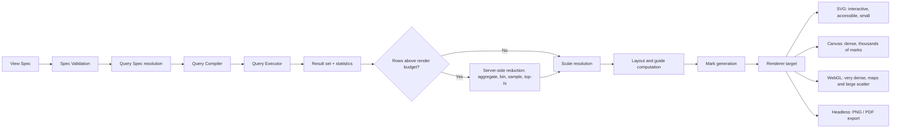

| Target | Threshold | Why |
|---|---|---|
| SVG | Up to a few thousand marks | Accessible by construction, crisp at any zoom, inspectable, easy to test |
| Canvas | Tens of thousands of marks | SVG's DOM cost dominates past this point |
| WebGL | Hundreds of thousands of marks | Maps, dense scatter, large time series |
| Headless | Any | Exports must use the same spec and the same renderer as the screen, or exported charts will drift from live ones |

**Aggregation happens on the server, always.** A chart never receives more rows than it can meaningfully draw. This is a correctness constraint as much as a performance one: sending a million rows to the browser to draw two hundred pixels of line is how a dashboard becomes unusable and how row-level data leaks past a masking policy.

### 9.5 Interaction model

| Interaction | Behaviour |
|---|---|
| Tooltip | Declared fields, formatted per the model; never a raw dump of the row |
| Cross-filter | Selecting a mark filters other charts on the dashboard; the filter is visible and individually removable |
| Drill-down | Follows the declared hierarchy; each level is a new query spec, never a client-side re-slice of stale data |
| Drill-through | Opens the underlying rows, subject to row- and column-level policy — a common leak path, and therefore explicitly policy-checked |
| Brush and zoom | Range selection on a continuous scale; re-queries at the new grain rather than magnifying pixels |
| Parameters | Named, typed inputs bound into query specs — date range, currency, scenario, threshold |
| Comparison | Period-over-period, versus target, versus segment; a declared mode rather than a hand-built duplicate chart |
| Annotation | Users attach commentary to a data coordinate; it becomes part of the shared chart |

### 9.6 Dashboards

| Property | Rule |
|---|---|
| Layout | Responsive grid with declared breakpoints; a dashboard must remain readable on a laptop, not only on the designer's monitor |
| Shared filters | Declared at the dashboard level, applied to every compatible chart, with per-chart exemptions declared explicitly |
| Refresh | Per-dashboard policy: on load, on interval, on dataset-ready event, or manual; the effective freshness is always displayed |
| Query batching | All charts on a dashboard resolve through one batched, deduplicated round-trip, sharing cached sub-results |
| Progressive load | Above-the-fold charts render first; the rest stream in |
| Permissions | Inherited from the datasets and metrics used; a dashboard can never grant more access than its least-permissive input allows |
| Versioning | Every save is a version with an author and a diff; restoring an old version is one action |
| Empty and error states | Declared per chart, not generic — "no data for this filter" is different from "the source failed to refresh", and conflating them costs trust |

### 9.7 Accessibility and colour — enforced, not encouraged

These are validation rules, checked before a spec can be saved, not guidelines in a style document:

- Text and marks meet a contrast ratio threshold against their background, in both light and dark themes.
- Categorical palettes are colour-blind-safe by default; sequential and diverging palettes are perceptually uniform.
- **No meaning is carried by colour alone.** A spec encoding a distinction only in `color` must also carry it in shape, pattern, position or a label. The validator rejects the alternative.
- Every chart carries alternative text generated from its own specification, and a keyboard-navigable data-table fallback.
- Colour meaning is consistent within a workspace: a semantic palette maps roles (positive, negative, target, forecast, category N) so that "red is bad" holds everywhere rather than per designer.
- Dark and light themes are both first-class; a chart is never a light-mode image pasted onto a dark page.

### 9.8 Performance budgets

| Budget | Target | Enforcement |
|---|---|---|
| Time to first chart from a dropped file | Under 60 seconds for a typical workbook | Phase 0 exit criterion |
| Interactive query at dashboard scale | 95th percentile under 2 seconds | Result cache, pre-aggregation, query budget |
| Marks rendered per chart | Reduced server-side to a declared ceiling | Renderer refuses an over-budget result rather than freezing the browser |
| Dashboard initial paint | Under 3 seconds for a ten-chart dashboard | Batching, progressive load, cached sub-results |
| Export generation | Under 30 seconds for a standard report | Headless render queue with a per-tenant concurrency limit |

A budget that is not enforced is a wish. Each of these is a test in CI (§19.2), failing the build when breached on the reference dataset.

---
## 10. Query and Execution Lifecycle

### 10.1 The query spec

Every question asked of the platform — by a chart, by exploration, by an alert, by an agent, by the API — is expressed as the same declarative structure. There is no second path, and in particular **no path that accepts raw SQL from a user interface**.

| Field | Meaning |
|---|---|
| `model` | Semantic model name and version. |
| `dimensions` | Fields to group by, each with an optional time grain or hierarchy level. |
| `measures` | Measures or metrics to aggregate, each with an explicit aggregation where the default is overridden. |
| `filters` | Typed predicates, including parameter references. Values are always bound, never interpolated. |
| `having` | Post-aggregation predicates. |
| `sort` | Ordered field list with direction and null placement. |
| `limit` / `offset` | Mandatory; the compiler injects the workspace default when absent. |
| `compare` | Optional comparison clause: previous period, same period last year, versus target, versus segment. |
| `grain` | Explicit output grain, verified against measure additivity. |
| `context` | Principal, workspace, locale, timezone, `now` — supplied by the platform, never by the caller. |

### 10.2 Compilation

The Query Compiler is a pure function from `(query spec, semantic model version, policy decision, engine profile)` to an immutable execution plan with a stable hash.

| Stage | Action | Failure |
|---|---|---|
| Resolve | Model version pinned; every field resolved to a model element | Unknown field → compile error with a suggestion |
| Validate | Aggregation legality checked against additivity; grain checked; join path resolved and unambiguous | Ambiguous join path → compile error naming the candidate paths |
| Authorise | Policy decision applied; RLS predicates injected; masked columns replaced by their masking expression | Denied → no plan is produced, and the denial is audited |
| Optimise | Predicate pushdown, projection pruning, aggregate pushdown to the source when the pushdown profile allows | — |
| Budget | Estimated scan and cost compared against the principal's budget | Over budget → rejected with the estimate shown, not silently truncated |
| Emit | Engine-specific plan produced through parameterised construction | — |

Two properties are non-negotiable. **RLS predicates are injected by the compiler, never by the caller** — a filter the user cannot see and cannot remove. And **no plan is ever produced by string concatenation of user-supplied values**; the compiler builds a structured plan and the executor binds parameters, which removes the injection class entirely rather than defending against it.

### 10.3 End-to-end sequence

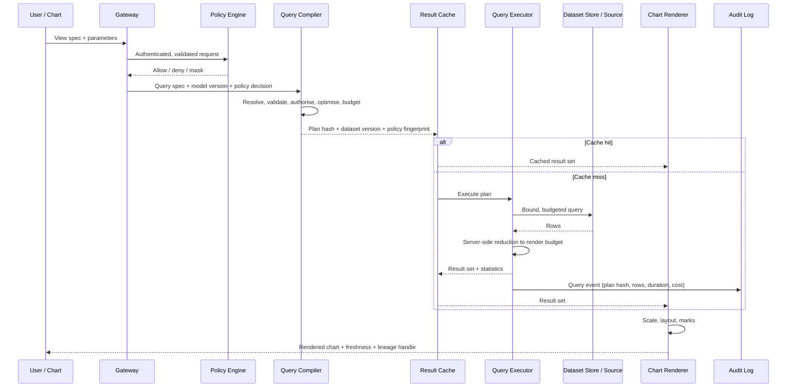

### 10.4 Import lifecycle state machine

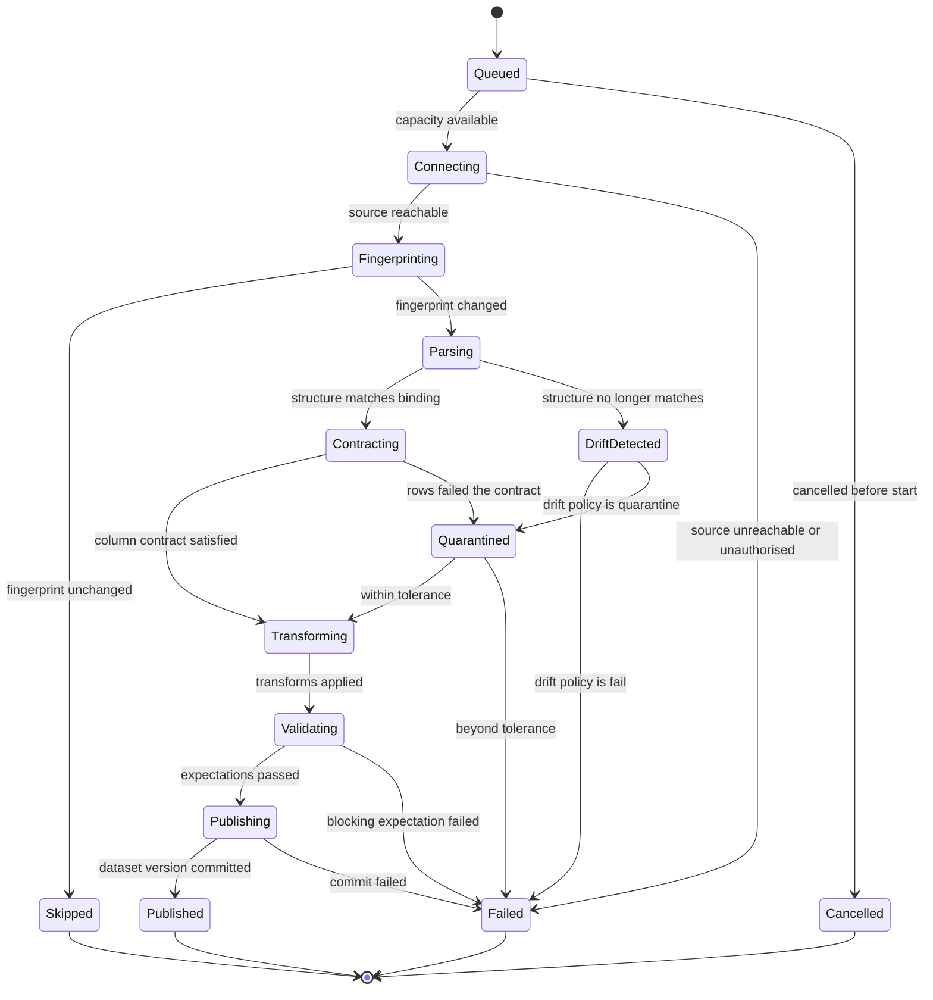

`DriftDetected` is a distinct state, not a variant of `Failed`. It means the source changed shape, which is a *governance* event needing a human decision and a binding update — not an outage. Collapsing it into `Failed` would hide exactly the class of event that most needs attention, and would train operators to ignore it.

`Quarantined` is likewise distinct: the import succeeded for the rows that satisfied the contract, and the rest are inspectable. Partial success that is visible beats both total failure and invisible loss.

### 10.5 Caching and invalidation

| Layer | Key | Invalidated by |
|---|---|---|
| Source fingerprint | Connector config | Time-based recheck |
| Dataset version | Plan hash + source fingerprint | A new import producing different content |
| Pre-aggregate | Model version + aggregate definition + dataset version | Dataset version change, model change |
| Query result | Plan hash + dataset versions + policy fingerprint | Any of the above, or a policy change affecting the principal |
| Rendered export | View spec version + result cache key + theme | Any of the above |

The **policy fingerprint in the cache key** is not an optimisation detail. Omitting it is the single most common way a BI system serves one user's row-filtered results to another user, and it is silent when it happens.

---

## 11. Data Flow and Contracts

Consistent with `docs/data-flow.md`: no raw input travels past validation, and no sensitive data reaches a log.

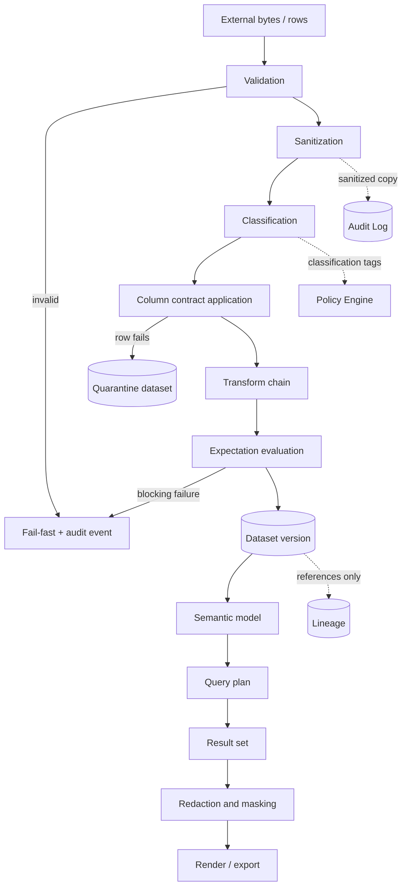

### 11.1 Data handling rules

| Rule | Rationale |
|---|---|
| All inputs are untrusted, including database responses and cell contents | A source system is not a trusted peer, and a spreadsheet cell is user input |
| Classification is assigned at ingress and travels with the column | Masking and residency cannot be decided later if the tag is lost |
| Sensitive values are masked at query time by the compiler, not by the renderer | A masking rule applied at the last moment has already crossed too many boundaries |
| The audit log records the *shape* of a query, never its result rows | Audit must be safe to retain and to read widely |
| Row-level data never leaves the server except as an aggregate, a declared drill-through, or an authorised export | The three exits are the three places to check policy |
| Payloads above a size threshold are stored by reference, never inlined | Keeps the catalog and audit log small, cheap and readable |
| Quarantined rows inherit the sensitivity of their source column | A failed row is not less sensitive for having failed |
| The audit log is append-only and schema-enforced | Audit integrity; enables lineage rebuild |
| Erasure is served by tombstoning dataset versions and re-importing, never by rewriting the audit log | Preserves the audit chain while honouring deletion of the payload |

### 11.2 Core contracts a developer must implement first

| Contract | Consumers | Stability requirement |
|---|---|---|
| Column contract | Binding author, Inference, Compiler, Load Runner, Quality Engine | The foundational contract; versioned, backward-compatible within a major version |
| Connector contract | Connectors, Registry, Load Runner, Query Executor | The public extension point on the input side |
| Dataset version descriptor | Store, Catalog, Lineage, Query Compiler | Internal but versioned; the hash is part of the audit record |
| Semantic model schema | Modelers, Query Compiler, Analyst Agent | Changes ripple to every chart; conservative by necessity |
| Query spec schema | Charts, Exploration, Alerts, API, Agents | The single question format; one path only |
| View spec schema | Renderer, Export, Embed, Agents | The public extension point on the output side |
| Policy decision contract | Gateway, Compiler, Executor, Export, Share | Small and total: allow, deny, mask, require-approval, with a reason code |
| Event schema | Load Runner, Executor, Observability, Agents, Pentest | Append-only; new fields optional, existing fields never repurposed |

---

## 12. AI Agent Model

Prism inherits the multi-agent model of `docs/agent-workflow.md` and the guardrails of `docs/agent-safety.md` without exception. The agents here serve two purposes that matter commercially: making a non-technical user productive on day one, and keeping a growing catalog from decaying into a swamp.

### 12.1 Agent roster

| Agent | Plane | Input | Output | May write to |
|---|---|---|---|---|
| **Data Steward Agent** | Ingestion (authoring) | A new file, a drifted source, profiler statistics | Draft binding, drift-repair proposal, column descriptions, candidate relationships | Draft store only |
| **Analyst Agent** | Presentation (authoring) | Natural-language question, semantic model, catalog | Draft query spec plus draft view spec, with the reasoning shown | Draft store only |
| **Narrator** | Insight | A chart, a dashboard, a change over time | Plain-language description of what the visual shows, and what changed | Documentation only |
| **Quality Agent** | Insight | Profiler output, expectation results, history | Proposed expectations, anomaly findings, freshness alerts | Proposal queue only |
| **Architecture Agent** | Authoring | Model set, lineage graph | Structural findings, decomposition proposals, diagrams | Documentation, draft proposals |
| **Pentest Agent** | Security | Bindings, transforms, query specs, share scopes, audit history | Risk scores, blocking findings, threat models | Policy findings; blocks via Policy Engine |
| **Documentation Agent** | Documentation | Catalog, models, dashboards | Data dictionary, model docs, changelogs | Documentation only |

### 12.2 The invariant

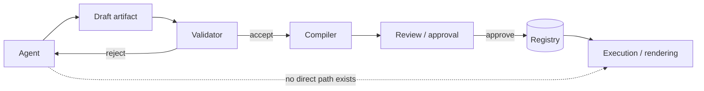

**No agent output reaches execution without passing the same validation and approval path as a human's.** An agent has no privileged channel, no raw SQL path and no ability to publish. This is what makes an AI-authored chart no more dangerous than a hand-authored one — and it is auditable, because the draft, the findings and the approval are all recorded.

### 12.3 What the agents are actually for

| Task | Why an agent earns its place |
|---|---|
| "Here is a file — what is in it?" | Structure detection plus profiling plus a proposed binding turns a twenty-minute manual chore into a review |
| "The monthly file changed shape again" | A drift-repair proposal against the previous binding, showing the diff, is far faster than re-authoring |
| "Show me revenue by region this quarter versus last" | Question → query spec → chart spec, all validated, all inspectable, all editable afterwards |
| "Explain this dashboard to me" | A narration generated from specs and results, not from an image |
| "What changed in this number since last week?" | Decomposition of a delta across dimensions — the single most-asked follow-up question in any business |
| "Are these two datasets the same thing?" | Near-duplicate detection over profiles and lineage keeps the catalog from rotting |
| "Write the documentation" | Column descriptions and model docs are the work nobody does, and their absence is what makes a catalog useless |

### 12.4 Autonomy tiers

Autonomy is a per-workspace, per-artifact-kind setting.

| Tier | Agent may | Human must |
|---|---|---|
| **T0 — Advisory** | Propose only; nothing is applied | Author and approve everything |
| **T1 — Assisted** | Draft bindings, models, queries and charts | Review and approve every publish |
| **T2 — Supervised** | Publish drafts into a personal or sandbox workspace; open a change request for shared artifacts | Approve promotion to a shared workspace |
| **T3 — Autonomous (bounded)** | Publish and refresh within a declared blast radius: non-certified artifacts, `internal` classification or below, no schema-breaking change, no share-scope change | Review after the fact; may revoke |

The default for a new workspace is **T1**, and promotion between tiers is a governed decision recorded like any other. T3 never extends to certified metrics, to sensitivity changes, or to anything that widens who can see data.

### 12.5 Prompt-injection posture

This deserves specific attention here, because Prism's agents read **cell contents** — the most under-defended injection surface in any data product. A spreadsheet column called "Notes" is attacker-controlled text that will be shown to a model.

- Data content is always framed as data, never as instructions, at every point where it enters an agent's context.
- Agents receive **profiles, schemas and aggregates by default**, not raw rows. Raw values reach an agent only when the task requires them, only within the requesting principal's access scope, and always as quoted, labelled data.
- No agent has execution privileges, so a successful injection yields at most a *draft* — which is then validated, risk-scored and reviewed.
- The Pentest Agent scans drafts for injected instruction patterns, unexpected connector additions, egress expansion, widened share scopes and sensitivity downgrades.
- A corpus of injection attempts embedded in cell values, column headers, sheet names and file names runs in CI (§19.2) and must produce blocked drafts rather than actions.
- Agent context never contains secrets, and the Secret Broker has no agent-facing interface at all.

---

## 13. Security Model

Zero-trust, per `ADR-0001` and `docs/pentest-flow.md`, applied to the specific shape of a data platform.

### 13.1 Trust boundaries

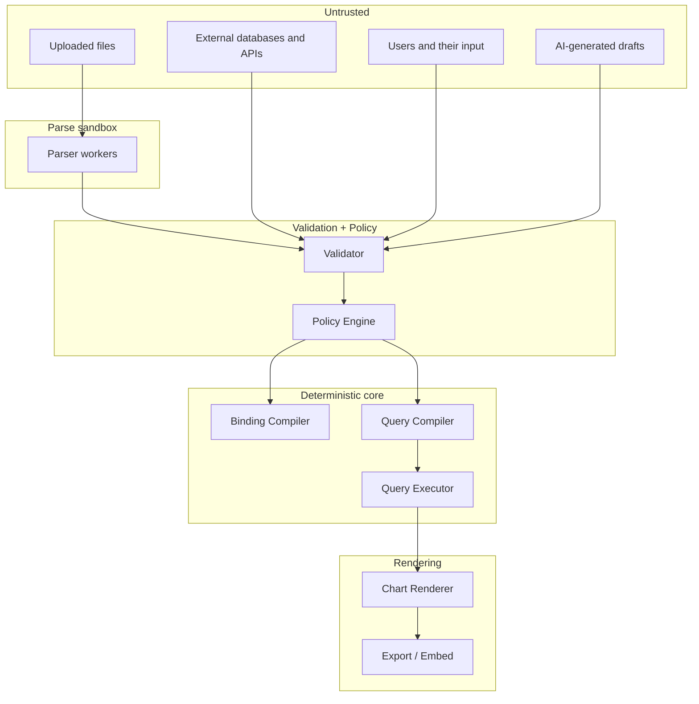

Two placements carry the whole posture. **AI-generated drafts sit on the untrusted side**, alongside uploaded files and user input. And **file parsing happens in an isolated sandbox before validation**, because a malicious file attacks the parser itself — validation of the parsed result is too late.

### 13.2 Threat model summary

| # | Threat | Vector | Control |
|---|---|---|---|
| T1 | Malicious file exploits a parser | Uploaded workbook, archive or document | Parse sandbox (§13.4): no network, read-only root, memory and time caps, no macro or formula evaluation, no external reference resolution, decompression-ratio limits |
| T2 | Formula injection into exported files | A cell value beginning `=`, `+`, `-`, `@` or a control character, exported to CSV or XLSX and opened by a victim | Output sanitisation on every export path; the value is preserved and neutralised, never silently altered in the stored data |
| T3 | Query injection | A filter value, a parameter, a field name, a saved search | Structured plan construction with bound parameters; no user-supplied SQL surface anywhere; identifier allow-listing from the model |
| T4 | Row-level security bypass | Drill-through, export, embed token, cache reuse, an agent-authored query | Policy applied at compile time and included in the cache key; drill-through and export re-checked; embed tokens carry a frozen policy scope |
| T5 | Over-broad sharing | Public links, embeds, guest access, forwarded reports | Expiring, revocable, scope-limited tokens; a share can never exceed the sharer's own rights; periodic access review; every share is audited |
| T6 | Credential leakage | Bindings, catalog, logs, error messages, exports | Secret Broker with short-lived leases; secrets never in an artifact; classification-driven redaction applied to error paths as well as success paths; secret scanning over the audit log in CI |
| T7 | Prompt injection through cell content | Any free-text column reaching an agent | Content-as-data framing, aggregates by default, no agent execution privilege, Pentest scan of drafts, CI injection corpus (§12.5) |
| T8 | Denial of service | Zip bombs, billion-laughs XML, enormous sheets, unbounded cross-joins, pathological regexes | Resource caps per parse and per query, decompression limits, entity expansion disabled, mandatory limits, cost budgets, circuit breakers |
| T9 | Server-side request forgery | A connector configuration pointing at an internal address | Egress allow-list per connector, private-range blocking by default, DNS-rebinding protection, redirect policy declared |
| T10 | Data exfiltration through exports | A user with legitimate read access extracting the entire dataset | Export volume limits per role, watermarking, full audit of exports, alerting on anomalous volume, drill-through row caps |
| T11 | Supply-chain compromise | Parser and driver dependencies, of which this product needs many | Pinned dependencies, dependency audit in CI, signed connector artifacts, connector allow-list per environment, minimal parse-sandbox image |
| T12 | Tampering with audit or lineage | State plane | Append-only storage, hash chaining, separate retention credentials, lineage rebuildable from the audit log |
| T13 | Residency or classification violation | A connector or export crossing a region | Classification tags evaluated by the Policy Engine before dispatch; region-scoped connector registration; export destinations allow-listed |
| T14 | Stale or wrong data presented as current | A silently failed refresh | Freshness displayed on every chart; failed refresh raises a visible banner and an alert; a dashboard past its freshness SLO degrades visibly rather than lying quietly |

T14 is a security concern, not merely an operational one. A dashboard that silently serves month-old numbers as current causes decisions to be made on false information, which is an integrity failure by any reasonable definition.

### 13.3 Least privilege in practice

- A connector receives a credential scoped to **one source, one operation, one import, one time window**.
- Egress is denied by default. A connector's declared `egress` allow-list is the only permitted destination set, and private address ranges are blocked unless explicitly allowed for a named internal source.
- The Query Executor has no write access to any source and no filesystem access outside its scratch space.
- Parse workers have **no network access at all**.
- Row-level security is expressed once, on the model, and applies uniformly to charts, exploration, drill-through, exports, alerts, the API and agents. A policy expressed per-surface will eventually be forgotten on one of them.
- Production connector registration requires a named owner and a Pentest Agent review.

### 13.4 Constraining the parse sandbox

Parsing untrusted files is the largest single risk in this product, in the way the shell executor is in the sibling product. It is therefore constrained beyond ordinary components:

| Constraint | Requirement |
|---|---|
| Isolation | A separate process in a separate container per parse job; no shared memory with the platform |
| Image | Pinned, minimal, scanned; no package installation at runtime |
| Filesystem | Read-only root; one writable scratch mount discarded at job end; the source file mounted read-only |
| Network | **None.** Not restricted — absent. A parser has no legitimate reason to make a request |
| Formula evaluation | Disabled. Cached values only. A formula with no cached value is an error, never a computation |
| External references | Never resolved: linked workbooks, remote images, external data connections, DDE fields |
| Macros and embedded objects | Never executed; extracted, hashed and reported as findings |
| XML processing | External entity resolution disabled, entity expansion bounded, DTDs rejected |
| Archives | Decompression ratio, output size, entry count and nesting depth all capped |
| Resources | Hard memory, CPU-time, wall-clock and output-size caps; exceeding one fails the job cleanly |
| Output | A typed record stream and a structure report only — never executable content, never a path outside the scratch mount |
| Approval | A new parser dependency requires a security review and enters the allow-list explicitly |

The rule that matters most is the network one. Every serious document-parser vulnerability class becomes dramatically less valuable to an attacker when the compromised process cannot reach anything.

---

## 14. Reliability and Failure Model

### 14.1 Guarantees

| Guarantee | Level | Mechanism |
|---|---|---|
| Import durability | An import accepted by the scheduler survives process and node restart | Checkpointed stages, durable queue |
| Import atomicity | A dataset version is either fully published or not published | Write-then-commit; readers never observe a partial version |
| Import idempotency | Re-running an import plan against unchanged source content produces no new version | Source fingerprint plus plan hash |
| Read consistency | A dashboard load sees one consistent set of dataset versions | Version pinning for the duration of a dashboard's batched query |
| Query determinism | The same plan against the same dataset versions returns the same result | Immutable versions, pinned model, no wall-clock dependence |
| Freshness honesty | Every result carries the age of its data | Freshness metadata propagated from dataset version to chart |
| Recovery point | The last successfully published dataset version | Immutable versions with retention |

### 14.2 Failure classification

| Class | Examples | Default handling |
|---|---|---|
| Transient | Network timeout, source rate limit, lock contention | Retry with exponential backoff and jitter |
| Contract | Column missing, type mismatch, expectation breach | No retry — the binding or the source is wrong; raise a drift finding |
| Data | Rows failing the contract within tolerance | Quarantine, continue, report the count |
| Authorisation | Policy denial, expired lease, revoked credential | Fail immediately, audit event, no retry |
| Resource | Parse or query exceeded a budget | Fail with the measured cost shown; suggest narrowing, sampling or pushdown |
| Systemic | Source unavailable, engine down, storage degraded | Pause affected imports, alert, resume automatically on recovery; serve last-known-good data with a visible staleness banner |
| Catastrophic | Corrupt dataset version, lineage inconsistency, audit gap detected | Freeze the affected artifacts, page a human, no automatic recovery |

### 14.3 Degradation strategy

The product must fail in a way that keeps it useful, and that never lies:

| Failure | Behaviour |
|---|---|
| A refresh fails | The previous dataset version continues to serve, with a visible staleness banner on every dependent chart and an alert to the owner |
| A live source is unreachable in pushdown mode | The last cached result serves, explicitly labelled with its age; there is no silent fallback |
| A single chart errors | Only that chart shows an error state; the dashboard renders the rest |
| A query exceeds budget | The chart offers a narrowed alternative — shorter range, coarser grain, top-N — rather than an unexplained failure |
| The AI layer is unavailable | Everything else works; agent surfaces are disabled with a notice, since no agent is in a critical path by design |
| Storage is degraded | Reads continue; imports queue rather than failing |

### 14.4 Blast-radius controls

- Per-workspace concurrency quotas for imports, queries and exports.
- Circuit breakers per connector and per source, tripping on error rate and latency.
- Cost ceilings per query, per dashboard load and per workspace per day, enforced by the compiler's budget stage.
- Canary refresh: a new binding version processes a sample and shows the diff against the previous version before full promotion.
- A kill switch per binding, per connector and per share, exercised in drills rather than discovered during incidents.

---

## 15. Observability and the Learning Loop

### 15.1 What is measured

| Level | Signals |
|---|---|
| Import | Duration, rows in / out / quarantined, drift findings, bytes, cost, terminal status |
| Dataset | Freshness, version count, size, expectation pass rate, schema stability over time |
| Query | Latency distribution, rows scanned and returned, cache hit rate, budget rejections, error class breakdown |
| Chart | Render time, mark count, reduction ratio, error and empty-state rate |
| Dashboard | Load time, view count, unique viewers, interaction depth, abandonment |
| Connector | Availability, latency, error rate, cost, circuit state |
| Catalog | Coverage of descriptions and owners, certified fraction, orphaned and stale artifacts |
| Platform | Queue depth, worker saturation, storage growth, audit-log lag |
| Governance | Share count and scope, export volume, drill-through volume, policy denials |

Two of these deserve emphasis because they answer product questions rather than infrastructure ones. **Dashboard abandonment** — opened, then closed without interaction — identifies dashboards that exist but do not answer anything. **Catalog coverage** is the honest measure of whether the platform is becoming an asset or a swamp.

### 15.2 Data quality monitoring

Expectations are declared on a binding and evaluated on every import. The Quality Agent proposes new ones from observed history, and every proposal is reviewed like any other.

| Expectation family | Examples |
|---|---|
| Schema | Column present, type stable, order-independent, no unexpected new columns beyond a declared tolerance |
| Volume | Row count within a band of the trailing distribution; a 90% drop is almost always a broken export, not a quiet month |
| Nullability | Null rate below a threshold per column |
| Uniqueness | Declared keys are actually unique — verified, never assumed |
| Referential | Foreign keys resolve against the referenced dataset version |
| Range and domain | Values within declared bounds; categorical values within the catalogued domain |
| Freshness | Maximum timestamp within a declared lag of `now` |
| Distribution | Mean, median or category mix within a band of the trailing distribution — the check that catches a silent unit change from euros to cents |

### 15.3 The learning loop

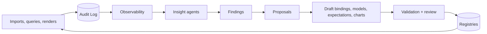

Findings the insight agents are expected to produce:

- datasets nobody has queried in ninety days, and dashboards nobody has opened,
- near-duplicate datasets and near-duplicate metric definitions,
- columns that are always null, and expectations that never fire,
- slow charts whose queries would benefit from a pre-aggregate, with the pre-aggregate proposed,
- bindings that quarantine a rising fraction of rows — a source degrading slowly rather than breaking cleanly,
- shares that have outlived their purpose, and guest access nobody has revoked,
- charts whose specification violates an accessibility or colour rule introduced after they were authored,
- dashboards whose freshness SLO is chronically missed.

Every finding is a proposal, never an edit. The loop closes through review, which is what makes it safe to run continuously.

---

## 16. Governance, Collaboration and Sharing

Scope expands fastest here, and ungoverned expansion is what turns a useful tool into an unmaintainable one.

### 16.1 Workspaces and roles

| Role | May |
|---|---|
| **Viewer** | Open shared dashboards, filter, drill within policy, export within limits |
| **Explorer** | Everything a viewer may, plus ad-hoc exploration and personal charts over datasets they can read |
| **Author** | Create and publish bindings, models, charts and dashboards in their workspace |
| **Steward** | Certify datasets and metrics, own expectations, approve binding changes, resolve drift |
| **Admin** | Manage connectors, secrets, workspaces, roles, quotas and retention |
| **Auditor** | Read the audit log, lineage and access reports; read no data rows |

The **Auditor** role existing separately from Admin is deliberate: reviewing who saw what should not require the ability to see it.

### 16.2 Certification and trust signals

Every dataset, metric and dashboard carries a visible status: `draft`, `reviewed`, `certified`, or `deprecated`. Certification requires a named owner, a description, passing expectations and a documented refresh policy. Certified artifacts are ranked first in search and are the only ones permitted in external shares and executive dashboards. Deprecated artifacts keep working through a grace period with a visible banner, then stop.

This is the mechanism that lets a catalog grow without decaying. Without it, the hundredth dashboard makes the first ninety-nine less trustworthy.

### 16.3 Collaboration surfaces

| Surface | Purpose |
|---|---|
| Comments and threads | Anchored to a dashboard, a chart, or a data point; the conversation stays with the number it is about |
| Annotations | Explanations anchored to data coordinates, visible to every viewer of the chart |
| Change requests | Proposed edits to a shared artifact, reviewed by its owner, with a rendered diff |
| Subscriptions | Scheduled delivery of a dashboard or report to email or chat, with the recipient's own policy applied |
| Alerts | Threshold, anomaly and freshness alerts on metrics, routed to owners |
| Data requests | A viewer asks for a dataset or a metric that does not exist yet; the request becomes a tracked item rather than an untracked message |

Applying **the recipient's own policy to a scheduled delivery** rather than the sender's is not a detail. The opposite behaviour — rendering as the sender — is how a subscription silently becomes a data leak.

### 16.4 Multi-tenancy

Isolation is designed in from Phase 1 rather than retrofitted, because retrofitting it is historically the most expensive mistake a platform of this shape can make. Tenancy boundaries apply to: catalog visibility, dataset storage, secrets, connector registration, quotas, result cache keys, audit partitions and agent context. A tenant's data is never a filter over shared storage that someone could forget to apply.

---

## 17. Migration Path — Replacing the Spreadsheet Estate

"Replace the reporting the company already does" is achieved by sequencing, not by a big bang.

### 17.1 Inventory and triage

| Step | Output |
|---|---|
| Discover | A register of the recurring reports and workbooks that matter: owner, source, frequency, audience, criticality |
| Classify | Each entry tagged by structural complexity (sheets, formulas, manual steps) and by risk (audience, sensitivity, decisions it drives) |
| Prioritise | Rank by *audience × frequency × manual effort ÷ risk*. High-effort, high-frequency, low-risk items first |
| Select the beachhead | Five to ten reports exercising at least three connector families and at least one genuinely messy workbook |

The beachhead must include a messy workbook. A migration validated only against clean CSVs will fail on contact with reality, and it will fail publicly.

### 17.2 The four migration patterns

| Pattern | When to use | Effort | Fidelity |
|---|---|---|---|
| **Mirror** — import the workbook's output sheet as-is and chart it | The workbook is a black box; its logic is unclear or owned elsewhere | Hours | Visibility, freshness and sharing improve immediately; the logic still lives in Excel |
| **Bind** — import the workbook's *input* sheets and rebuild the calculations as declared transforms and measures | The logic is understood and moderate | Days | The spreadsheet becomes an input, not a dependency |
| **Model** — connect the underlying system directly and retire the workbook entirely | A real source system exists behind the spreadsheet | Weeks | Full determinism, freshness and reuse |
| **Rebuild** — design the analysis from the question, not from the existing report | The report accumulated by habit and nobody defends its structure | Days to weeks | Highest quality; requires business input |

Most reports should travel **Mirror → Bind → Model**, and it is legitimate for a low-value report to stop at Mirror permanently. Forcing full modelling everywhere is how migration programmes stall.

### 17.3 Cutover protocol

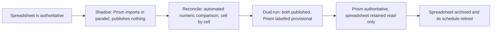

The **reconciliation step is the trust-building step and must be automated**, not eyeballed. A reconciliation report showing every difference between the spreadsheet's numbers and Prism's — with each difference explained as a rounding rule, a filter difference, a date-boundary convention or a genuine error in one of the two — is what converts a sceptical finance team. In practice it also finds real errors in the spreadsheet, which is uncomfortable and extremely valuable.

Shadow mode requires the connector `dryRun` flag from §7.1. Building it in from day one is far cheaper than retrofitting it.

---
## 18. Technology Choices — Contracts First, Defaults Named

The boundaries in §5 are mandatory. The technologies below are **recommended defaults**: they let a developer start on Monday without a week of evaluation, and each one is replaceable behind its contract. Where a choice is genuinely load-bearing, that is said explicitly.

| Concern | Recommended default | Alternatives | Why the default, and how locked-in it is |
|---|---|---|---|
| **Analytical engine over the dataset store** | DuckDB, embedded in the query worker | ClickHouse, Apache DataFusion, delegating everything to the source | Zero-operations, columnar, excellent Parquet and Arrow support, fast enough for the overwhelming majority of departmental datasets. **Replaceable**, because the Query Compiler emits an engine-specific plan behind an engine-profile contract. Scale out by adding a second engine profile, not by rewriting |
| **Dataset storage format** | Parquet files in object storage, partitioned, with a manifest per version | Native engine storage, Delta/Iceberg table formats | Open, portable, readable by every tool the company will ever buy, and content-addressable. **Load-bearing**: choosing a proprietary format here would undo the portability argument |
| **Object storage** | S3-compatible (MinIO for self-hosted) | Local filesystem for single-node, cloud-native buckets | One API from a laptop to a cluster |
| **Metadata store** | PostgreSQL — catalog, bindings, models, view specs, audit index, lineage edges | Any relational store | Boring, transactional, well understood, excellent JSON support for schema-flexible artifacts. **Load-bearing** in the sense that the platform assumes transactional metadata |
| **Spreadsheet parsing** | A streaming XLSX reader plus a legacy XLS reader, both running only inside the parse sandbox | Language-specific equivalents | The constraint that matters is §13.4, not the library. Streaming rather than DOM-loading is required: a DOM-loading parser turns a large workbook into an out-of-memory incident |
| **Backend runtime** | Python for connectors, ingestion, profiling and agents (the ecosystem for parsing, statistics and models is unmatched); a compiled language is a reasonable choice for the query and orchestration path if throughput demands it | Node/TypeScript throughout, Go, Rust, .NET | The repository already standardises Python and PowerShell conventions (`copilot-instructions.md`). Mixed runtimes are acceptable because the boundaries are process boundaries |
| **API style** | REST with a versioned OpenAPI contract, plus long-polling or SSE for import progress | GraphQL | The API surface is artifact-shaped and cache-friendly; GraphQL's flexibility buys little here and complicates policy enforcement |
| **Frontend** | TypeScript with a component framework of the team's choice | — | Not architecturally load-bearing; the view spec is the contract, not the framework |
| **Chart rendering** | A grammar-of-graphics renderer driven by the view spec, with D3 (or an equivalent) for scales, layout and axes; Canvas and WebGL layers for dense marks | A charting library used directly | **Load-bearing**: the spec must be the source of truth. A library used directly becomes the schema, and the spec degenerates into that library's configuration format, losing portability, server-side rendering parity and static checkability |
| **Headless export** | The same renderer running in a headless browser in a queue worker | A separate server-side charting library | Two renderers guarantee two behaviours; the point of the spec is that this does not happen |
| **Job execution** | A durable queue with worker pools per class (parse, load, query, render, export) | An external workflow engine, including OmniFlow | Separate pools mean a slow parse cannot starve interactive queries |
| **Result cache** | Redis for small results, object storage for large ones, keyed per §10.5 | In-process cache for single-node | The policy fingerprint in the key matters far more than the technology |
| **Secrets** | An external secret manager behind the Secret Broker contract | Encrypted columns with a KMS-held key for single-node | The contract is what matters; never store a secret in a binding |
| **Authentication** | OIDC with SCIM provisioning; local accounts for single-node | SAML | Groups must map to roles automatically, or access review becomes manual and therefore neglected |
| **Deployment** | Docker Compose for development and single node; Kubernetes optional and unchanged in container contract | — | Identical to the sibling product's assumption, deliberately |
| **Observability** | OpenTelemetry traces and metrics; structured JSON logs | — | Vendor-neutral; the audit log is separate from and more durable than the log stream |

Two rules govern every row of this table. **The engine profile is a contract**, so a second analytical engine is an addition rather than a migration. And **the view spec is a contract**, so the renderer can be replaced without invalidating a single saved chart. Everything else is a preference.

---

## 19. CI/CD and Testing Strategy

Per `docs/ci-cd.md`: deterministic builds, fail-fast, security-first, immutable artifacts. Prism extends the pipeline to treat **bindings, models and view specs as first-class build artifacts**.

### 19.1 Pipeline

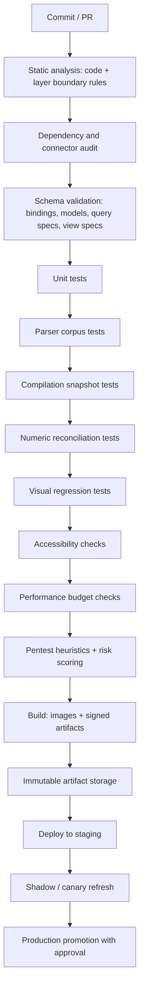

### 19.2 Test pyramid

| Level | Scope | Determinism requirement |
|---|---|---|
| Unit | Type system, expression evaluation, scale computation, transform semantics | Fully deterministic |
| **Parser corpus** | A curated library of real, ugly files — merged cells, multi-row headers, locales, encodings, 1900 leap year, cross-tabs, hidden sheets, malformed archives — each with an expected structure report and dataset | Byte-identical output required; a diff is a regression |
| **Compilation snapshot** | Binding → import plan and query spec → execution plan, asserting the exact plan hash for a fixture set | Byte-identical; catches accidental semantic changes in one line |
| **Numeric reconciliation** | Reference workbooks with known correct answers, plus the migration reconciliation harness (§17.3) | Exact to declared precision |
| Contract | Each connector against a recorded or sandboxed source | Recorded fixtures per PR; live tests nightly |
| Integration | Ingest → model → query → render across containers | Deterministic modulo timing |
| **Visual regression** | Reference view specs rendered and compared against golden images, in light and dark themes | Pixel comparison within a declared tolerance |
| **Accessibility** | Contrast, colour-blind simulation, redundant encoding, alt-text presence, keyboard navigation | Must pass; failures block |
| **Performance budget** | The §9.8 budgets measured against a reference dataset | Must pass; regressions block |
| Chaos | Source failures mid-import, worker kills, storage latency injection | Asserts recovery and no partial versions |
| Security | Malicious file corpus, injection corpora (SQL, formula, prompt), SSRF attempts, RLS bypass attempts, export-limit tests | Must pass; critical findings block promotion |

Three of these catch entire classes of defect cheaply and deserve to be built before they feel necessary. The **parser corpus** is the product's real regression suite — every customer-reported parsing bug becomes a permanent file in it. **Plan-hash assertions** turn "did anyone accidentally change compilation semantics?" into a one-line failure. **Visual regression** is the only way to know that a renderer refactor did not quietly change what a chart communicates.

Coverage thresholds inherit the repository standard: 80% minimum, 90% for Core, the type system, the Binding Compiler, the Query Compiler and the Policy Engine.

---

## 20. Repository Structure

Following the repository naming conventions: folders and files in `kebab-case`.

```
/
├─ .github/
│  ├─ copilot-instructions.md
│  ├─ agents/
│  │   ├─ architecture.agent.md
│  │   ├─ documentation.agent.md
│  │   ├─ pentest.agent.md
│  │   ├─ data-steward.agent.md
│  │   └─ analyst.agent.md
│  └─ workflows/                  # CI/CD pipeline definitions
├─ .copilot/
│  └─ prompts/
│      ├─ architecture.prompt.md
│      ├─ documentation.prompt.md
│      ├─ refactor.prompt.md
│      ├─ binding-authoring.prompt.md
│      └─ chart-authoring.prompt.md
├─ core/                          # type system, models, errors, validation + logging primitives
├─ data/
│  ├─ connectors/
│  │   ├─ contract/               # the connector contract + registry
│  │   ├─ spreadsheet/
│  │   ├─ delimited/
│  │   ├─ embedded-db/
│  │   ├─ relational/
│  │   ├─ columnar/
│  │   ├─ object-storage/
│  │   ├─ http/
│  │   └─ notification/
│  ├─ detection/                  # structure detector, type inference
│  ├─ binding/                    # binding schema, compiler, registry
│  ├─ load/                       # load runner, quarantine, dataset store
│  ├─ transform/
│  ├─ profile/                    # profiler, quality engine
│  ├─ semantic/                   # model registry, metrics
│  └─ query/                      # query spec, compiler, executor, cache
├─ presentation/
│  ├─ spec/                       # view spec schema + validation
│  ├─ recommend/                  # chart recommendation rules
│  ├─ render/                     # renderer: svg, canvas, webgl, headless
│  ├─ dashboard/
│  ├─ explore/
│  └─ export/                     # pdf, png, xlsx, csv, embed
├─ security/
│  ├─ policy/                     # rbac, rls, masking
│  ├─ secret-broker/
│  ├─ sandbox/                    # parse isolation
│  └─ pentest/
├─ insight/
│  ├─ observability/
│  ├─ lineage/
│  └─ agents/
├─ schemas/                       # binding, plan, dataset, model, query, view, event, policy
├─ catalog/                       # catalog service + search
├─ deploy/                        # compose files, container definitions, environment config
├─ fixtures/
│  ├─ parser-corpus/              # the ugly-file library
│  ├─ golden-images/              # visual regression baselines
│  └─ reconciliation/             # reference workbooks with known answers
├─ tests/
└─ docs/
   ├─ architecture.md
   ├─ system-overview.md
   ├─ modules.md
   ├─ data-flow.md
   ├─ component-diagram.md
   ├─ type-system.md
   ├─ binding-authoring-guide.md
   ├─ chart-authoring-guide.md
   ├─ connector-authoring-guide.md
   ├─ agent-workflow.md
   ├─ agent-safety.md
   ├─ pentest-flow.md
   ├─ ci-cd.md
   └─ adr/
       ├─ ADR-0001-core-architecture.md
       └─ ADR-0003-dataset-and-visualization-model.md
```

The `fixtures/parser-corpus/` directory is unusual enough to justify: it is the accumulated knowledge of every way a real spreadsheet has broken the importer, and over time it becomes the most valuable directory in the repository.

---

## 21. Build Roadmap

Each phase ends with something that works and can be demonstrated. No phase depends on a later phase's existence.

### Phase 0 — Walking Skeleton

**Goal:** drop a file, get a chart, share a link.

| Deliverable | Definition of done |
|---|---|
| Type system v0 | The closed type set of §6.4, with parsing and formatting per locale |
| Binding schema v0 | Single sheet, single header row, explicit column contract, no transforms |
| Structure Detector v0 | Header-row detection and data-region detection with confidence scores |
| Type Inference v0 | Ranked candidates with evidence; ambiguity blocks publication |
| Binding Compiler v0 | Binding → import plan with a deterministic hash |
| Load Runner v0 | Parse in the sandbox, apply the contract, write a Parquet dataset version |
| Spreadsheet + CSV connectors | Streaming, `dryRun` honoured, fingerprinting |
| Query Compiler and Executor v0 | Group-by, aggregate, filter, sort, limit over one dataset; bound parameters only |
| View spec v0 and renderer | Bar, line, table; SVG target; formatting from the column contract |
| Chart recommendation v0 | The rules of §9.3 for one and two field combinations |
| Catalog and audit log | Searchable dataset list; append-only event record |
| Sharing v0 | A read-only link scoped to one chart |
| Container deployment | A compose file brings the whole thing up on one machine |

**Exit criterion:** a non-technical user drops a real, moderately messy `.xlsx`, confirms two inference decisions, and has a correct, shareable, correctly formatted chart in under 60 seconds — and the complete history of how that chart's numbers were produced is reconstructable from the audit log alone.

### Phase 1 — A Real Platform

**Goal:** something a department would rely on for its monthly reporting.

| Deliverable | Definition of done |
|---|---|
| Full structure handling | Multi-row headers, merged cells, multiple regions, cross-tab unpivot, multi-sheet union, hidden-sheet policy |
| Transform Engine | The chain of §6.7, compiled and type-checked end to end |
| Refresh modes | Snapshot, append with watermark, key upsert, partition replace; fingerprint skip |
| Drift detection | `onMissing` and `onTypeChange` enforced; `DriftDetected` state; drift findings surfaced to owners |
| Quarantine | Side dataset, tolerance policy, counts surfaced on the dataset |
| Database connectors | PostgreSQL, MySQL, SQL Server, SQLite, Access; pushdown profiles declared |
| Semantic model v1 | Entities with grain, relationships, measures with additivity, metrics |
| Profiler and Quality Engine | Statistics on every version; declared expectations; blocking failures |
| Chart vocabulary v1 | Comparison, trend, part-to-whole, distribution, relationship, tabular, KPI |
| Dashboards | Layout, shared filters, parameters, cross-filter, batched queries |
| Exploration | Drill-down, drill-through under policy, breakdown-by, comparison modes |
| Refresh Scheduler | Schedules, concurrency, deduplication, cost ceilings |
| Roles and permissions | The role set of §16.1; dataset- and dashboard-level access |
| Export | PDF, PNG, XLSX, CSV with formula-injection neutralisation |
| Lineage | Forward and backward impact answers over the full graph |

**Exit criterion:** five real monthly reports migrated by the Mirror or Bind pattern run on schedule for two months with no manual intervention, and a deliberately shape-changed source file produces a clear drift finding rather than a wrong number.

### Phase 2 — Trust, Governance and Scale

**Goal:** the platform can be trusted with data that matters, by people who did not build it.

| Deliverable | Definition of done |
|---|---|
| Row- and column-level security | Expressed on the model; applied uniformly to every surface including exports and alerts; verified by bypass tests |
| Multi-tenancy | Isolation of catalog, storage, secrets, quotas, cache and audit |
| Certification workflow | Draft → reviewed → certified → deprecated, with ownership and grace periods |
| Pentest Agent | Heuristics over bindings, transforms, query specs and share scopes; risk scores blocking promotion |
| Parse sandbox hardening | Every constraint in §13.4 implemented and adversarially tested |
| Alerts and subscriptions | Threshold, anomaly and freshness alerts; recipient-scoped delivery |
| Pushdown mode | Live query against capable sources with cost budgets and honest freshness labels |
| Pre-aggregation | Declared aggregates, automatic use by the compiler, correct invalidation |
| Performance budgets | The §9.8 targets enforced in CI against a reference dataset |
| Observability | Metrics, traces, SLOs, alerting; the governance dashboard of §15.1 |
| Chaos and recovery tests | Worker kill mid-load leaves no partial dataset version |
| Accessibility enforcement | Validation rules of §9.7 blocking a non-conforming save |

**Exit criterion:** an adversarial review — a malicious workbook, an RLS bypass attempt, an SSRF attempt through a connector configuration, and an export-exfiltration attempt — produces blocked, audited findings and no data exposure.

### Phase 3 — The AI Layer

**Goal:** a person who cannot write SQL is genuinely productive, with the safety invariant intact.

| Deliverable | Definition of done |
|---|---|
| Data Steward Agent | New file → draft binding; drifted source → repair proposal with a diff |
| Analyst Agent | Question → draft query spec plus view spec; every draft passes the same validation path as a human's |
| Narrator | Plain-language explanation of any chart, dashboard, and change over time |
| Delta decomposition | "Why did this number move?" answered by contribution across dimensions |
| Quality Agent | Proposed expectations from observed history; anomaly findings |
| Documentation Agent | Generated data dictionary and model documentation, kept current |
| Autonomy tiers | T0–T3 configurable per workspace and artifact kind; T1 default |
| Injection defence | Aggregates-by-default context, content-as-data framing, Pentest scanning of drafts, CI corpus covering cell values, headers, sheet names and file names |

**Exit criterion:** a non-technical user describes a question in prose and, after review, gets a correct chart — and an instruction embedded in a spreadsheet cell produces a blocked draft and a finding rather than any action.

### Phase 4 — Ecosystem

**Goal:** many teams, many sources, self-service, embedded.

| Deliverable | Definition of done |
|---|---|
| Connector SDK and marketplace | Internal teams publish signed connectors against the contract, with a conformance suite |
| Embedding | Signed, scoped, expiring embed tokens; a themeable embedded view; documented integration |
| Public API | Versioned, documented; query specs and view specs are first-class API objects |
| Warehouse pushdown | Snowflake, BigQuery, ClickHouse and Databricks profiles with cost governance |
| Geospatial and advanced visuals | Maps, flows, cohorts, control charts |
| Write-back connectors | Governed publication of curated datasets, per §7.5 |
| Optional Kubernetes deployment | Horizontal scaling of parse, query and render pools; the container contract unchanged from Phase 0 |
| Compliance pack | Retention, residency, audit export, access review, evidence generation |
| OmniFlow integration | The three contracts of §7.6, both directions, in production |

**Exit criterion:** a team unfamiliar with the platform onboards its own source, publishes a certified dashboard and operates it without the platform team's involvement.

---

## 22. Sizing, Team and Effort

Indicative, for a competent team building against this document. Actuals depend on the connector surface and the chart vocabulary required.

| Phase | Duration | Team | Primary risk |
|---|---|---|---|
| 0 | 4–6 weeks | 2 engineers | Over-designing the binding schema before it has imported anything real |
| 1 | 10–14 weeks | 3–4 engineers | Underestimating spreadsheet structure detection — it is the hardest part of the product and looks like the easiest |
| 2 | 10–14 weeks | 4–5 engineers plus security review | Row-level security retrofitted per surface instead of enforced once at compilation |
| 3 | 8–12 weeks | 3–4 engineers plus an AI-focused engineer | Autonomy creeping ahead of the validation invariant |
| 4 | Ongoing | 5–7 engineers | Connector sprawl with inconsistent quality |

Three decisions dominate the schedule, and all three are made before Phase 1 ends:

1. **The column contract.** It is the public contract of the data half. Getting drift policy, locale handling and refresh identity right early avoids re-binding every source later. Keep it *small* in Phase 0 — it is easier to add a field than to remove one.
2. **The view spec schema.** It is the public contract of the visual half, and every saved chart depends on it. Design it as a grammar, not as a union of chart-type configurations, or adding the eleventh chart type will require a migration of the first ten.
3. **Where policy is enforced.** Deciding in Phase 0 that row-level security is injected by the Query Compiler — and nowhere else — costs a week. Discovering in Phase 2 that it was implemented separately in charts, exports, alerts and the API costs a quarter and a security incident.

---

## 23. Risks and Mitigations

| # | Risk | Impact | Likelihood | Mitigation |
|---|---|---|---|---|
| R1 | Structure detection is harder than estimated; imports need constant hand-holding | The core promise fails; users go back to Excel | High | Parser corpus from week one; confidence-scored proposals with human confirmation rather than silent guessing; the Data Steward Agent as an accelerator, not a substitute |
| R2 | The transform language grows into a programming language by accretion | Loses reviewability and static analysability — the core value proposition | High | A closed transform set; anything beyond it moves into a connector or upstream; schema changes require an ADR |
| R3 | Silent wrong numbers reach a decision | Catastrophic loss of trust; the platform is abandoned | Medium | Fail-loud drift policy, mandatory freshness display, reconciliation harness at migration, additivity enforcement, lineage on every chart |
| R4 | A malicious file compromises a parse worker | Security incident | Medium | The §13.4 sandbox, network-free by construction; malicious-file corpus in CI; pinned, minimal, scanned parser images |
| R5 | Row-level security is bypassed through a secondary surface | Data exposure | Medium | Enforcement at compilation only; policy fingerprint in the cache key; bypass tests across every surface as a release gate |
| R6 | Catalog decays into a swamp of duplicated, unowned artifacts | Nobody trusts anything; search becomes useless | High | Certification and ownership requirements, duplicate detection, staleness reporting, enforced deprecation |
| R7 | Performance collapses on the first genuinely large dataset | Users conclude the product does not scale | Medium | Server-side reduction always; budgets enforced in CI; pushdown for large sources; pre-aggregation |
| R8 | The renderer diverges from the specification as chart types are added | Exports and embeds stop matching the screen | Medium | One renderer, one spec, visual regression tests across all targets; no chart type without a spec extension |
| R9 | AI features are trusted beyond their reliability | Wrong analyses published confidently | Medium | T1 default, validation invariant, reasoning always shown, no direct execution path |
| R10 | Connector sprawl with inconsistent quality | Unreliable imports, duplicated adapters | Medium | Connector contract conformance suite, signing, ownership requirement, review before production registration |
| R11 | Storage growth from retained dataset versions becomes unaffordable | Cost pressure to weaken versioning and thereby lineage | Medium | Retention policy per binding, deduplication by content hash, columnar compression, tiered storage — never deletion of the audit chain |
| R12 | Migration stalls after the beachhead | Two reporting systems to operate indefinitely | Medium | Explicit retirement criteria per report; migration progress tracked as a first-class metric; Mirror is an acceptable permanent destination for low-value reports |
| R13 | Accessibility and colour rules are added late | Every existing chart becomes non-conforming at once | Medium | Rules enforced at save from Phase 2; existing specs migrated by a one-time proposal pass |
| R14 | Scope expands faster than the team | Nothing reaches production quality | High | Phase exit criteria are gates, not suggestions; each phase must ship something demonstrable |

R3 deserves emphasis. Every other risk on this list is recoverable. A platform that once put a confidently wrong number in front of an executive does not get a second chance, which is why fail-loud drift handling and always-visible freshness are architectural requirements rather than features.

---

## 24. Open Questions

These require a decision before or during Phase 1 and should each end in an ADR.

| # | Question | Why it matters |
|---|---|---|
| Q1 | Dataset storage — Parquet plus a hand-rolled version manifest, or an open table format such as Iceberg or Delta? | Table formats bring time travel and schema evolution for free, at the cost of a heavier dependency and operational surface |
| Q2 | Analytical engine — embedded per worker, or a shared engine service? | Embedded is simpler and faster to start; a shared service handles concurrency and large datasets better |
| Q3 | Expression language for derived columns and filters — adopt an existing sandboxed language or define a minimal one? | Adoption cost versus control over the non-Turing-complete guarantee |
| Q4 | View spec — define our own grammar, or adopt an existing published grammar as the schema? | Adopting brings tooling and a specification for free but constrains extension; defining one is more work and more control |
| Q5 | Is the semantic model mandatory before charting, or is the implicit model of §8.4 permanent? | Affects onboarding friction against long-term consistency; the answer shapes the whole first-run experience |
| Q6 | Multi-tenancy — designed in from Phase 1 or retrofitted at Phase 4? | Retrofitting isolation is historically the most expensive mistake available here |
| Q7 | How much raw data may an agent see, and under what consent? | The difference between a genuinely useful assistant and a data-governance problem |
| Q8 | Dataset version retention defaults, and residency defaults | Compliance obligations and storage cost |
| Q9 | Does the platform ever write back to source systems beyond §7.5's narrow cases? | Write-back changes the security posture from read-only to bidirectional, permanently |
| Q10 | Real-time and streaming — a Phase 4 connector family, or explicitly out of scope? | Affects the freshness contract and the caching model throughout |

---

## 25. Glossary

| Term | Definition |
|---|---|
| **Source Binding** | Declarative document defining how a source becomes a dataset: connector, structure, column contract, transforms, expectations, refresh |
| **Import Plan** | Immutable, content-addressed compilation of a binding with all versions and structure resolved |
| **Dataset Version** | One immutable, content-addressed materialisation of a binding against source content at a point in time |
| **Column Contract** | The per-column declaration of identity, type, locale, role, sensitivity and drift policy |
| **Structure Detection** | Locating the table inside a source: header rows, data regions, footers, cross-tabs |
| **Drift** | A source whose shape no longer matches its binding |
| **Quarantine** | The side dataset holding rows that failed the column contract, with their reasons |
| **Semantic Model** | The declared meaning layer: entities with grain, relationships, dimensions, measures, metrics |
| **Grain** | What one row of an entity represents; the property whose ambiguity causes double-counting |
| **Additivity** | Whether a measure may be summed across a dimension: additive, semi-additive, non-additive |
| **Metric** | A named, owned, certified business definition built from measures and filters |
| **Query Spec** | The single declarative form of every question asked of the platform |
| **Execution Plan** | The compiled, engine-specific, policy-injected form of a query spec; content-addressed by plan hash |
| **View Spec** | The declarative definition of a visual: query reference, mark, encodings, scales, guides, interactions |
| **Mark** | The geometric primitive a chart draws: bar, line, point, arc, rect, geoshape |
| **Encoding** | The mapping from a data field to a visual channel: x, y, colour, size, shape |
| **Pushdown** | Executing a query in the source engine rather than materialising the data |
| **Materialize** | Copying source data into the dataset store as a versioned artifact |
| **Fingerprint** | A cheap signal of whether a source's content has changed since the last import |
| **Freshness** | The age of the data behind a result, displayed wherever the result is |
| **Lineage** | The traceable graph from source through binding, dataset, model and metric to chart |
| **Certification** | The trust status of an artifact: draft, reviewed, certified, deprecated |
| **RLS** | Row-level security: a policy predicate injected by the Query Compiler that a user cannot see or remove |
| **Policy fingerprint** | The hash of a principal's effective access, included in every cache key |
| **Parse sandbox** | The network-free, resource-capped isolation in which all untrusted file parsing occurs |
| **Autonomy tier** | T0–T3; how much an agent may do without human approval |
| **Dry run** | Reading and validating a source without persisting, used for preview and shadow migration |
| **Plan hash** | Content address of an import or execution plan; recorded for audit and regression testing |

---

## Cross-References

| Document | Relationship |
|---|---|
| `.github/copilot-instructions.md` | Authoritative behavioural and convention rules; this document conforms to them |
| `docs/architecture.md` | Parent architecture; extended here with the Data and Presentation layers |
| `docs/adr/ADR-0001-core-architecture.md` | Foundational decision this design builds on |
| `docs/adr/ADR-0003-dataset-and-visualization-model.md` | The decision record for the model specified in §6 and §9 |
| `docs/modules.md` | Module boundaries; extended with the components of §5 |
| `docs/data-flow.md` | Data flow rules applied in §11 |
| `docs/agent-workflow.md` / `docs/agent-safety.md` | Agent behaviour and guardrails applied in §12 |
| `docs/pentest-flow.md` | Security workflow applied in §13 |
| `docs/ci-cd.md` | Pipeline standards extended in §19 |
| `omniflow-architecture-and-vision.md` | Sibling product; shares conventions and posture, integrates through the three contracts of §7.6 |

---

## Final Notes

The design rests on two ideas and one invariant.

The first idea: **an import is a compiled contract, not a copy**. A binding is reviewable, diffable, replayable and statically analysable, and a source that changes shape breaks it loudly instead of poisoning a dashboard quietly. This is what separates a data platform from a folder of spreadsheets, and it is the difference between a number you can defend and a number you merely have.

The second idea: **a chart is a specification, not a picture**. One declarative grammar, validated before it renders, drives the screen, the export and the embed alike — which makes charts portable, checkable for accessibility, explainable in prose, and safe for an agent to author.

The invariant, inherited from the sibling product and non-negotiable here: **the AI proposes, the engine disposes**. Every agent output — a binding, a query, a chart — crosses the same validation, risk-scoring and approval boundary as any untrusted input. This is what makes an ambitious AI surface compatible with the zero-trust posture the repository already demands.

A developer can start on Monday with §6, §9 and Phase 0, and have a real spreadsheet turned into a correct, shareable, traceable chart inside six weeks. Everything after that is addition, not correction.
